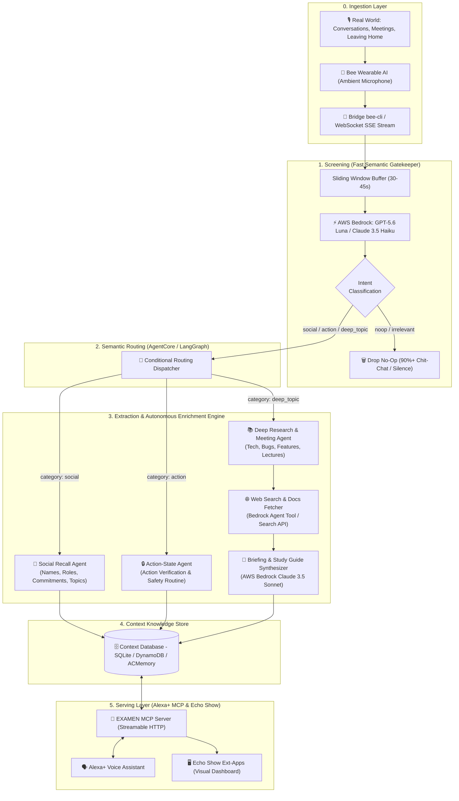

# 📐 System Architecture & End-to-End Dataflow (5 Stages)

> This document details the **5 fundamental stages** of the **EXAMEN** architecture *(from Latin "exāmen": a swarm of bees and a careful examination)*, showing how raw audio streams captured by the **Bee** wearable are transformed into structured, enriched insights served via **Alexa+** on **Echo Show**.

> [!NOTE]
> **Baseline Reference (v1.0):** This document reflects the foundational 5-stage conceptual pipeline. In the current implementation:
> 1. Ingestion operates via **per-utterance screening** with a 4-chunk FIFO context ring buffer (`src/ingestion/ring_buffer.py`) rather than a 30–45s sliding window.
> 2. The Gatekeeper evaluates 5 categories (including `scheduled_task`) as an ingestion filter before LangGraph dispatch.
> 3. Serving exposes **22 MCP tools** and a Next.js 14 dashboard, backed by SQLite and Amazon DynamoDB with multi-user isolation ([13_multi_user_accounts.md](13_multi_user_accounts.md)).
> 4. See [12_full_repo_recap.md](12_full_repo_recap.md), [17_aws_deployment_runbook.md](17_aws_deployment_runbook.md), and [next_steps/ROADMAP.md](next_steps/ROADMAP.md) for the active production architecture.

---

## 🗺️ End-to-End Architecture Flowchart



---

## 1. Stage 1: Screening (Semantic Gatekeeper)

### The Continuous Ambient Listening Challenge
A wearable microphone running all day produces hours of continuous speech:
* **Over 90–95% of transcriptions** consist of ambient noise, transient pleasantries, background chatter, or ephemeral talk with zero long-term informational value.
* Passing every audio chunk to complex reasoning models (like Sonnet or GPT-4) would generate unacceptable latency (5–10s) and prohibitive token consumption.

### The Solution: Ultra-Light Gatekeeper on AWS Bedrock
The initial filter uses an ultra-fast, cost-effective model hosted on **AWS Bedrock**, powered by the dual-provider engine (`GATEKEEPER_PROVIDER=bedrock|mantle`):
* **Native Bedrock Converse API:** `amazon.nova-micro-v1:0`, `anthropic.claude-3-5-haiku-20241022-v1:0`, or `nvidia.nemotron-nano-3-30b` / `nvidia.nemotron-super-3-120b`.
* **Bedrock Mantle (OpenAI-compatible):** `openai.gpt-5.6-luna` or open-weight models via `bedrock-mantle.{region}.api.aws/openai/v1`.

* **Ingestion Mechanism:** The client collects utterances from `bee-cli` into a **Sliding Window** (30–45s time slice) with a 5-second overlap to prevent clipping sentences mid-thought.
* **Minimal Structured Output:** The gatekeeper classifies the chunk into a compact payload:
  ```json
  {
    "category": ["social", "action", "deep_topic"], // or ["noop"]
    "confidence": 0.94,
    "summary_hint": "Introduction between Marco and user with exchange of contact info."
  }
  ```
* **Dynamic Active Tasks Injection:** If the user has active pending routines or tasks (e.g. *"unplug clothes iron"*, *"take evening medication"*), the ingestion layer injects these titles into the Gatekeeper system prompt. This guarantees that expected tasks are prioritized and flagged as `"action"` with zero latency.
* **Early Exit (Drop No-Op):** If categorized as `noop`, execution terminates immediately. Over 90% of ambient chatter is filtered out, preserving downstream compute and token budgets.

---

## 2. Stage 2: Dynamic Semantic Routing

Chunks passing the gatekeeper are forwarded to the agentic state graph managed via **LangGraph / AgentCore**.

* **Multi-Label Dispatch:** A conversation can simultaneously contain a contact exchange and a completed task (e.g., *"I just merged the database PR, by the way nice to meet you, I'm Alessandro"*). The router triggers parallel or sequential execution across specialized sub-agents.
* **Temporal Context Preservation:** Every chunk is enriched with runtime metadata:
  - `timestamp`: Exact ISO timestamp of the occurrence.
  - `session_id`: Unique identifier for the continuous listening session.
  - `ambient_context`: Optional environmental tags.

---

## 3. Stage 3: Extraction & Autonomous Enrichment

### Channel 3A: Social Recall Engine
* **Purpose:** Capture names, professional roles, and bilateral commitments made during meetings, conferences, or casual encounters.
* **Extracted Schema:**
  - `person_name`: Name and surname.
  - `company_or_role`: Organization, title, or professional context.
  - `commitments`: Explicit bilateral promises (e.g., *"I'll email the repo tomorrow"*, *"He will send the invoice"*).
  - `key_topics`: Salient topics discussed.
* **Entity Deduplication:** If the contact already exists in the context store, the node updates the existing record with the new interaction rather than creating duplicates.

### Channel 3B: Dual Action Tracking — Planned Routines & Ambient Discovery
EXAMEN provides a unified ledger for both scheduled routines and spontaneous domestic/work actions:

1. **Planned Tasks & Daily Routines (`PlannedTask`):**
   - Scheduled explicitly via Alexa voice commands, Echo Show UI, or external calendar/task sync (`create_planned_task`).
   - Supports recurrence (`none`, `daily`, `weekdays`, `weekly`), scheduled target times, and status tracking (`pending`, `completed`, `overdue`, `skipped`).
   - Injected dynamically into Stage 1 Gatekeeper prompt to watch for their completion.

2. **Spontaneous Ambient Actions (`VerifiedAction`):**
   - Discovered autonomously from everyday ambient speech (*"I just turned off the oven"*, *"Merged PR #42"*).
   - Strict Veracity Filtering distinguishes between **completed assertions** (*"I just unplugged the iron"*) and **hypothetical/future intentions** (*"I should remember to unplug the iron"*).
   - Confidence threshold $\ge 0.80$ with second-precision timestamps.

3. **Autonomous Auto-Resolution Engine:**
   - When a `VerifiedAction` is committed, the context store automatically correlates it against active `pending` tasks.
   - Matching tasks are marked `completed`, linked to `verified_action_id` and timestamped, bridging planned routines and ambient voice proof.

### Channel 3C: Deep Meeting & Lecture Intelligence
* **Purpose:** Monitor technical discussions, design reviews, and academic lectures. When salient topics arise, the system proactively performs **autonomous background research**.
* **Detection Targets:**
  - **Tech & Engineering:** Complex bugs discussed, proposed features, architectural patterns, or emerging libraries (e.g. *AgentCore, DuckDB, OpenTelemetry, microservices*).
  - **Academic & Education:** Theoretical concepts, theorems, or methodologies covered in a lecture.
* **Autonomous Enrichment Workflow:**
  1. The agent extracts core topics and generates focused search queries.
  2. Invokes an autonomous **Web Search** tool (via DuckDuckGo Search / Bedrock Agent Action Group).
  3. Retrieves authoritative definitions, documentation, and code examples.
  4. An analytical model (**AWS Bedrock Claude 3.5 Sonnet**) synthesizes an **Executive Briefing** or **Study Guide**:
     - Concise executive summary.
     - Deep dive technical dossier with verified source links.
     - Concrete follow-up action items.

---

## 4. Stage 4: Context Knowledge Store

All extracted facts, planned routines, and enriched briefings flow into a unified context database (SQLite locally, or DynamoDB + AgentCore Memory on AWS).

```
┌─────────────────────────────────────────────────────────────────────────────┐
│                            EXAMEN_CONTEXT_STORE                             │
├───────────────────┬───────────────────┬───────────────────┬─────────────────┤
│   planned_tasks   │ verified_actions  │  social_contacts  │ topic_briefings │
├───────────────────┼───────────────────┼───────────────────┼─────────────────┤
│ id                │ id                │ id                │ id              │
│ title             │ action_type       │ person_name       │ topic_title     │
│ domain (safety/wrk│ domain            │ company_or_role   │ context_type    │
│ scheduled_time    │ raw_statement     │ commitments (JSON)│ summary (JSON)  │
│ recurrence        │ timestamp         │ key_topics (JSON) │ web_sources     │
│ status            │ confidence_score  │ timestamp         │ report_markdown │
│ completed_at      │ is_revoked        │                   │ action_items    │
│ verified_action_id│ matched_task_id   │                   │                 │
│ created_at        │                   │                   │                 │
└───────────────────┴───────────────────┴───────────────────┴─────────────────┘
```

---

## 5. Stage 5: Serving Layer (Alexa+ MCP Server & Echo Show UI)

Stored context is exposed to the ambient home/office environment via **Alexa+**:

### Model Context Protocol (MCP) Tools for Alexa+
The backend runs an MCP server conforming to the streamable-HTTP transport, enabling Alexa+ to natively invoke EXAMEN tools:

| MCP Tool | Example User Query | Returned Response |
| :--- | :--- | :--- |
| `create_planned_task` | *"Alexa, remind me to unplug the iron every morning at 08:30."* | Creates scheduled `PlannedTask` with daily recurrence and watches for ambient completion. |
| `verify_action_status` | *"Alexa, did I unplug the clothes iron?"* | *"Yes, at 08:14 you confirmed unplugging the iron with 96% confidence."* + Green badge on screen. |
| `get_daily_actions_recap` | *"Alexa, what did I get done today?"* | Dual report: completed planned routines, pending/overdue checks, and spontaneous actions. |
| `query_social_contact` | *"Alexa, who was Marco that I met this morning?"* | *"Marco Rossi is Tech Lead at Acme Corp. You agreed to send him the EXAMEN documentation."* |
| `get_topic_briefing` | *"Alexa, show me the briefing on the new tech discussed today."* | Displays interactive briefing on Echo Show with summaries, web links, and action items. |

### Visual Dashboard on Echo Show (Ext-Apps)
On screen-enabled devices (**Echo Show 8, 10, 15**), EXAMEN renders an interactive multimodal UI via the **ext-apps iframe SDK**:
* **Peace of Mind & Checklist Card:** Dual list showing scheduled routines ([✓] completed with verified timestamp, [!] pending/overdue) alongside spontaneous actions.
* **Social Profile Card:** Profile badges with mutual commitments and open tasks.
* **Deep Research Viewer:** Scrollable cards reviewing technical dossiers and web references.
