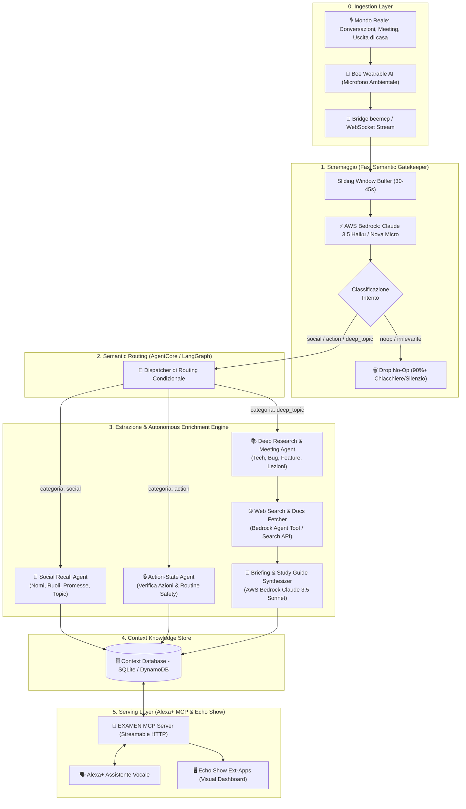

# 📐 Architettura di Sistema & Flusso dei Dati (5 Stadi)

> Questo documento descrive in dettaglio i **5 stadi fondamentali** dell'architettura di **EXAMEN** *(dal latino "sciame d'api" ed "esame attento")*, illustrando come il flusso audio grezzo catturato dal wearable **Bee** viene trasformato in informazioni strutturate, arricchite e rese fruibili da **Alexa+** su **Echo Show**.

---

## 🗺️ Diagramma di Flusso End-to-End



---

## 1. Stadio 1: Scremaggio (Semantic Gatekeeper)

### Il Problema dell'Ascolto Ambientale Continuo
Un dispositivo indossabile che ascolta l'ambiente produce diverse ore di parlato al giorno. 
* Oltre il **90-95% delle trascrizioni** è costituito da conversazioni banali, battute casuali, rumore di fondo o frasi senza valore informativo permanente.
* Passare l'intero stream a modelli linguistici pesanti e costosi (es. Sonnet o GPT-4) comporterebbe latenze inaccettabili (5-10 secondi) e costi elevati per token.

### La Soluzione: Gatekeeper Ultra-Light su AWS Bedrock
Il primo filtro adotta un modello ultraleggero ed economico erogato tramite **AWS Bedrock** (es. `anthropic.claude-3-5-haiku-20241022-v1:0` o `amazon.nova-micro-v1:0`).

* **Meccanismo di Ingestion:** Il client raccoglie le trascrizioni provenienti da `beemcp` aggregandole in una **Sliding Window** (finestra temporale di 30-45 secondi) con sovrapposizione di 5 secondi per non tagliare concetti a metà frase.
* **Output Strutturato Minimo:** Il gatekeeper valuta il chunk e restituisce esclusivamente un payload compatto:
  ```json
  {
    "category": ["social", "action", "deep_topic"], // oppure ["noop"]
    "confidence": 0.94,
    "summary_hint": "Presentazione tra Marco e l'utente con scambio di contatti."
  }
  ```
* **Early Exit (Drop No-Op):** Se la categoria è `noop`, l'esecuzione si arresta immediatamente. Nessuna risorsa di calcolo aggiuntiva viene impiegata.

---

## 2. Stadio 2: Routing Semantico Dinamico

I chunk che superano la fase di scremaggio vengono inviati all'orchestrazione agentica gestita tramite **AgentCore / LangGraph**.

* **Supporto Multi-Label:** Una conversazione può includere sia un contatto che un'azione completata (es. *"Ho appena completato il deploy del database, a proposito piacere sono Alessandro"*). Il router assegna il chunk in parallelo o in sequenza alle rispettive pipe di estrazione.
* **Preservazione del Contesto Temporale:** Ogni chunk viene arricchito con metadati di runtime:
  - `timestamp`: Orario esatto dell'avvenimento.
  - `session_id`: Identificativo della sessione continua di ascolto.
  - `ambient_context`: Informazioni opzionali di localizzazione o contesto dell'evento.

---

## 3. Stadio 3: Estrazione Informazioni & Autonomous Enrichment

A seconda dell'instradamento, il sistema attiva sub-agenti specializzati:

### Canale 3A: Social Recall Engine
* **Scopo:** Salvare nomi, anagrafiche e impegni reciproci presi durante presentazioni, meeting o networking.
* **Logica di Estrazione:**
  - `person_name`: Nome e cognome della persona.
  - `company_or_role`: Ruolo lavorativo, azienda o contesto di appartenenza.
  - `commitments`: Promesse bidirezionali esplicite (es. *"ti mando la demo domani"*, *"mi invierà la fattura"*).
  - `key_topics`: Tag tematici discussi.
* **Deduplicazione Entità:** Se il nome della persona coincide con un contatto già presente nel database, il nodo aggiorna la scheda arricchendola con la nuova interazione anziché creare un record duplicato.

### Canale 3B: Action-State & Routine Task Ledger (Peace of Mind)
* **Scopo:** Risolvere l'ansia quotidiana (*"Ho chiuso il gas?", "Ho staccato la piastra?", "Ho chiuso la porta a chiave?"*) e tracciare le azioni lavorative compiute (*"Ho pubblicato la nuova versione", "Ho scritto a Roberto"*).
* **Filtro Stringente di Veridicità:**
  - Distingue tra **dichiarazione compiuta** (*"Ho chiuso la finestra prima di uscire"*) e **ipotesi / dubbio** (*"Dovrei ricordarmi di chiudere la finestra"*).
  - Assegna un punteggio di confidenza da `0.0` a `1.0`. Solo asserzioni con confidenza $\ge 0.80$ vengono memorizzate come azioni verificate.
  - Timestamp esatto al secondo per consentire la verifica puntuale.

### Canale 3C: Deep Meeting & Lecture Intelligence (Novità & Alto Valore)
* **Scopo:** Monitorare discussioni tecniche, riunioni di lavoro e lezioni universitarie. Quando emergono argomenti rilevanti, il sistema non si limita a registrarli, ma esegue un **approfondimento autonomo proattivo**.
* **Cosa Rileva:**
  - **Mondo Tech/Lavoro:** Bug complessi discussi, feature da implementare, menzione di nuovi framework, librerie o tecnologie emergenti (es. *AgentCore, DuckDB, OpenTelemetry, architetture a microservizi*).
  - **Mondo Education/Università:** Concetti teorici complessi, definizioni, teoremi o metodologie citate durante una lezione accademica.
* **Processo di Arricchimento Autonomo (Web Research):**
  1. L'agente estrae i topic chiave da approfondire e genera query di ricerca mirate.
  2. Invoca un tool di **Web Search** (tramite AWS Bedrock Agent Search Tool o API dedicata).
  3. Recupera definizioni ufficiali, documentazione, best practice ed esempi di codice o spiegazioni accademiche.
  4. Un modello analitico (**AWS Bedrock Claude 3.5 Sonnet**) redige un **Executive Briefing** o uno **Study Guide**:
     - Sommario dell'argomento discusso.
     - Spiegazione tecnica approfondita con collegamenti alle fonti web.
     - Elenco di eventuali Action Items o bug ticket correlati.

---

## 4. Stadio 4: Salvataggio Dati (Context Knowledge Store)

Tutti i dati estratti e arricchiti confluiscono in un database strutturato unificato (SQLite per operare a latenza zero in locale, oppure DynamoDB su AWS).

```
   ┌────────────────────────────────────────────────────────┐
   │                  BEE_CONTEXT_DATABASE                  │
   ├───────────────────┬───────────────────┬────────────────┤
   │  social_contacts  │ verified_actions  │ topic_briefings│
   ├───────────────────┼───────────────────┼────────────────┤
   │ id                │ id                │ id             │
   │ name              │ action_type       │ topic_title    │
   │ company_role      │ domain (safety/wrk│ category       │
   │ commitments (JSON)│ raw_statement     │ raw_discussion │
   │ key_topics        │ timestamp         │ web_sources    │
   │ last_seen         │ confidence_score  │ report_markdown│
   │ interaction_count │ is_revoked        │ action_items   │
   └───────────────────┴───────────────────┴────────────────┘
```

* **Indicizzazione Full-Text (FTS5):** Permette ricerche rapide da parte di Alexa+ anche con frasi colloquiali e sinonimi.
* **Integrità Transazionale:** Ogni aggiornamento è atomico e tracciabile temporalmente.

---

## 5. Stadio 5: Serving Layer (Alexa+ MCP Server & Echo Show UI)

I dati memorizzati non rimangono confinati nel database: vengono resi accessibili e vivi nell'ambiente domestico o lavorativo tramite **Alexa+**.

### Protocollo MCP (Model Context Protocol) per Alexa+
Il backend espone un server MCP conforme allo standard di Alexa+, consentendo al modello di Alexa di invocare nativamente i tool di EXAMEN:

| Tool MCP Esposto | Esempio Query Utente | Valore Restituito |
| :--- | :--- | :--- |
| `verify_action_status` | *"Alexa, ho staccato il ferro da stiro?"* | *"Sì, alle 08:14 hai confermato di aver staccato il ferro con certezza del 95%."* + Badge a schermo. |
| `get_daily_actions_recap` | *"Alexa, cosa ho fatto oggi?"* | Timeline ordinata di tutte le azioni e task completati durante la giornata. |
| `query_social_contact` | *"Alexa, chi era Marco che ho incontrato stamattina?"* | *"Marco è il Tech Lead di Acme Corp. Ti sei impegnato a mandargli la documentazione di EXAMEN."* |
| `get_topic_briefing` | *"Alexa, mostrami il report sulle nuove tecnologie discusse oggi."* | Apre a schermo il dossier completo generato autonomamente con spiegazioni, fonti web e diagrammi. |

### Visual Dashboard su Echo Show (Ext-Apps Iframe SDK)
Oltre alla sintesi vocale naturale di Alexa, su dispositivi muniti di schermo (come **Echo Show 8, 10, 15**), EXAMEN attiva un'interfaccia ricca multimodale basata su **ext-apps**:
* **Peace of Mind Card:** Visualizzazione dello stato dei dispositivi domestici con timestamp verde di verifica.
* **Social Contact Card:** Mini-scheda profilo con foto o avatar, ruolo aziendale e to-do pendenti.
* **Deep Research Viewer:** Vista a schede scorrevoli per consultare i dossier tecnici generati automaticamente.
