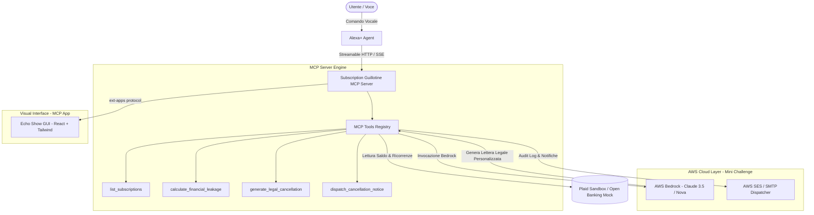

# 🗡️ Subscription Guillotine

> **Track:** Alexa+ (Pure Model Context Protocol & MCP Apps)  
> **Mini-Challenge Eleggibile:** AWS Builder ($5.000 cash + $5.000 AWS credits)  
> **Target Device:** Echo Show 8/10/15 (Multimodal) + Web/Mobile Companion  
> **Tagline:** *"Non limitarti a monitorare le spese: decapitale con un comando vocale."*

---

## 1. Visione & Valore Unico

### Il Problema Reale
Le persone continuano a perdere decine o centinaia di euro ogni mese a causa di abbonamenti dimenticati, rinnovi automatici ingannevoli e "dark patterns": pulsanti di disdetta nascosti, flussi di retention infiniti, questionari d'uscita obbligatori e clausole contrattuali oscure. Le app di finanza personale tradizionali (es. Rocket Money) si limitano a inviare notifiche passive o pretendono commissioni percentuali, lasciando all'utente l'onere burocratico di cancellarsi.

### La Soluzione "Clever"
**Subscription Guillotine** trasforma Alexa+ da passivo assistente Q&A in un **agente d'azione esecutivo**:
1. Connette le transazioni ricorrenti tramite Open Banking (mock o Plaid Sandbox).
2. Sfrutta **MCP Apps (ext-apps iframe)** per proiettare sullo schermo dell'Echo Show un'interfaccia visiva drammatica e accattivante: una "ghigliottina finanziaria" che illustra il "cimitero delle spese passive" e il denaro bruciato all'anno.
3. Con un solo comando vocale (*"Alexa, decapita la palestra Fitness First"*), l'agente MCP non si limita a un link: **redige autonomamente una diffida/disdetta legale formale**, compila i dati dell'intestatario e la spedisce via email/PEC certificata al provider, archiviando la ricevuta e aggiornando il bilancio.

---

## 2. Allineamento con i Criteri dei Giudici Amazon

| Criterio Ufficiale | Come lo soddisfa Subscription Guillotine |
| :--- | :--- |
| **Tech Implementation (25%)** | Utilizzo rigoroso dello standard **MCP (spec 2025-11-25+, Streamable HTTP)** con tool calls strutturate, schema JSON e rendering iframe interattivo tramite estensioni MCP Apps. |
| **Design & Multimodality (25%)** | Esperienza multimodale perfetta per Echo Show: voce (D-pad/input naturale) combinata a una UI grafica touch screen dinamica e reattiva. |
| **Potential Impact (25%)** | Risolve un problema da miliardi di dollari di attrito economico per consumatori di ogni fascia d'età. |
| **Quality of Idea (Creative vs Obvious) (25%)** | I criteri ufficiali di Alexa+ penalizzano i *"single-turn Q&A bot"* e premiano esplicitamente *"agentic workflow that orchestrates across services autonomously, context-aware add-on, media support (cards/MCP Apps), and purchasing/action capabilities"*. Questo progetto è esattamente ciò che i giudici cercano. |

---

## 3. Architettura Tecnica & Stack

### Componenti Software
* **MCP Server:** Node.js / TypeScript che espone l'endpoint con trasporto **Streamable HTTP**.
* **Frontend MCP App:** React + Vite compresso in iframe conforme alle specifiche `modelcontextprotocol.io/extensions/apps`. Grafici con Recharts/Chart.js stile "Dark/Gothic Financial Guillotine".
* **AWS Bedrock (Integrazione AWS Builder):** Prompting specialistico addestrato sui diritti dei consumatori (es. *Diritto di Recesso UE Direttiva 2011/83/UE* o *FTC Click-to-Cancel Rule* USA) per generare lettere inoppugnabili con codice cliente, estremi di pagamento e revoca RID/SEPA.
* **Email Dispatcher:** AWS SES o Nodemailer con recapito immediato e tracciamento delivery.

---

## 4. Nuove Funzionalità ad Alto Impatto (Idee di Espansione)

1. **"Zombie Alert" Proattivo:** Se una sottoscrizione non registra attività (es. abbonamento streaming non aperto da 45 giorni o palestra senza check-in), Alexa+ avvia un prompt proattivo: *"Hai speso 49€ per Audible questo trimestre ma hai ascoltato 0 ore. Vuoi che prepari la ghigliottina?"*.
2. **"Counter-Offer Shield" (Negoziazione Automatica):** Molti servizi offrono il 50% di sconto appena provi a disdire. L'agente analizza l'offerta di retention via webhook e chiede a schermo: *"Ti offrono 6 mesi a 2,99€ anziché 9,99€. Accetti lo sconto o procedo con l'esecuzione?"*.
3. **Calcolatore "Tempo di Vita Risparmiato":** Traduce i 30€/mese dell'abbonamento inutile in ore di lavoro necessarie per guadagnarli o in pasti risparmiati.

---

## 5. Criticità Tecniche & Strategie di Mitigazione

| Criticità / Rischio | Impatto | Strategia di Mitigazione Hackathon |
| :--- | :--- | :--- |
| **Autenticazione bancaria reale complessa** | Alto | Utilizzare **Plaid Sandbox** o un mock server realistico pre-popolato con 8 abbonamenti tipici (Netflix, Spotify, Gym, Cloud Storage, VPN, Magazine). Nella demo sembra 100% reale. |
| **Fornitori che ignorano le disdette email** | Medio | Includere nel testo generato da Bedrock gli articoli di legge e la diffida di revoca dell'addebito bancario (blocco SEPA). Mostrare nella demo che l'email arriva alla casella del fornitore con ricevuta crittografica. |
| **Latenza di risposta vocale** | Medio | Utilizzare lo streaming SSE per far rispondere Alexa mentre Bedrock genera il testo completo in background. |

---

## 6. Mini-Challenges & Friction Log Bonus

* **AWS Builder ($5k cash + $5k credits):** 
  Usare **Amazon Bedrock** per il legal parsing e generazione delle lettere e **AWS SES** per l'inoltro delle email. Documentare l'integrazione nell'apposito campo Devpost.
* **Open Source ($5k cash + $5k credits):**
  Rilasciare il pacchetto `mcp-banking-cancellation-tool` come libreria open source riutilizzabile su npm/GitHub con licenza MIT.
* **Friction Log (+10% Bonus):**
  Documentare i passaggi di configurazione del protocollo Streamable HTTP su Alexa+, evidenziando i workaround per il reverse tunneling locale (Cloudflare Tunnel vs ngrok).

---

## 7. Struttura del Video Demo (2:50 min)

* **0:00 - 0:30 (Il Gancio):** Mostra un estratto conto pieno di micro-transazioni dimenticate. *"Tutti abbiamo abbonamenti zombi che succhiano denaro."*
* **0:31 - 1:15 (L'Esperienza Multimodale):** Mostra l'Echo Show con la GUI interattiva che illustra la ghigliottina e il breakdown dei costi.
* **1:16 - 2:00 (L'Azione Vocale):** *"Alexa, decapita la palestra"*. L'agente MCP entra in azione, invoca Bedrock, compila il modulo legale e spedisce la disdetta in diretta.
* **2:01 - 2:30 (Il Risultato):** Ricevuta via email, aggiornamento immediato della dashboard, audio di conferma di Alexa con il totale annuo risparmiato.
* **2:31 - 2:50 (Tech Stack & AWS):** Breve schermata architetturale: Alexa+ MCP + AWS Bedrock + React Ext-Apps.
