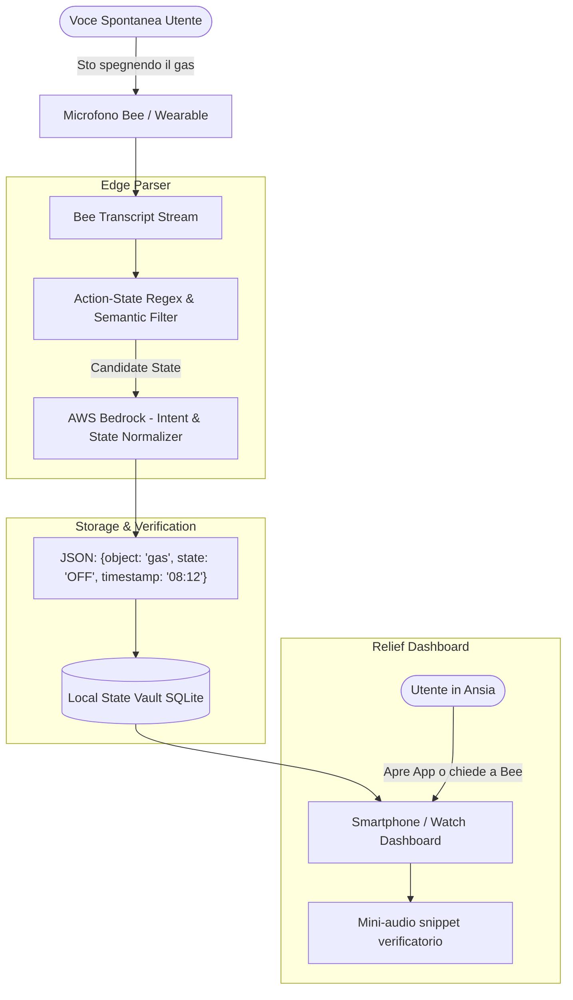

# 🧘 The "Action-State" OCD Reliever

> **Track:** Bee (Wearable AI / Ambient Computing)  
> **Mini-Challenge Eleggibile:** AWS Builder ($5.000 cash + $5.000 AWS credits)  
> **Target Device:** Bee Wearable Hardware / Apple Watch  
> **Tagline:** *"L'antidoto all'ansia quotidiana: dichiara l'azione, Bee ne certifica l'avvenuto stato."*

---

## 1. Visione & Valore Unico

### Il Problema Reale
Quasi ogni persona al mondo ha provato almeno una volta la paralisi da dubbio: *"Ho spento il ferro da stiro?"*, *"Ho chiuso la porta di casa a chiave?"*, *"Ho chiuso il gas?"*, *"Ho preso la pillola delle 8?"*. 
Poiché queste azioni sono automatiche e abitudinarie, il cervello non ne conserva un ricordo cosciente nitido. Risultato: ansia paralizzante al lavoro, viaggi di ritorno a casa nel traffico solo per controllare la porta, o chiamate angosciate ai vicini.

### La Soluzione "Clever"
La scienza comportamentale ha dimostrato che la tecnica giapponese dello **"Pointing and Calling"** (indicare e verbalizzare ad alta voce un'azione) azzera gli errori umani.
**The Action-State OCD Reliever** trasforma questa tecnica in un registro digitale certificato tramite Bee:
1. Quando esci o fai un'azione critica, la pronunci ad alta voce alla stanza vuota: *"Sto staccando il ferro da stiro"* o *"Porta chiusa con due mandate"*.
2. Bee rileva il pattern linguistico di stato dichiarativo (`[Azione] + [Oggetto] + [Stato]`), genera una card crittografica con timestamp esatto e archivia l'evento.
3. Ore dopo, quando l'ansia ti assale in ufficio, non devi guidare verso casa: guardi l'app companion o fai un tap sull'orologio:
   > 🟢 **Ferro da stiro:** Staccato alle **08:14:22**  
   > 🟢 **Porta d'ingresso:** Chiusa a chiave alle **08:16:05**  
   > 🟢 **Pillola della pressione:** Assunta alle **08:05:10**
4. Se vuoi la prova assoluta, puoi ascoltare gli ultimi 3 secondi dell'audio originale con il rumore del click della mandata o della spina sfilata!

---

## 2. Allineamento con i Criteri dei Giudici Amazon

| Criterio Ufficiale | Come lo soddisfa Action-State OCD Reliever |
| :--- | :--- |
| **Tech Implementation (25%)** | Pipeline di processing continuo con **Bee CLI / Bee-Skill**, classificazione semantica degli "Action States" e database locale persistente con query istantanea. |
| **Design (25%)** | Dashboard "Zero-Friction": basta parlare naturalmente, senza aprire app prima dell'azione. UI a semafori verdi/rossi ad alta leggibilità. |
| **Potential Impact (25%)** | Risolve un problema di salute mentale e benessere che affligge centinaia di milioni di persone con ansia generalizzata o abitudini ossessivo-compulsive lievi. |
| **Quality of Idea (25%)** | L'idea è brillante perché **non richiede sensori IoT costosi su ogni porta o elettrodomestico**: usa solo la voce umana già presente e l'ascolto continuo di Bee. |

---

## 3. Architettura Tecnica & Stack

### Componenti Software
* **Trascrizione & Ingestion:** `bee-cli stream --format json` collegato via WebSocket locale.
* **Normalizzazione Semantica (AWS Bedrock):** Converte frasi colloquiali eterogenee in tuple standardizzate:
  * *"Ho staccato la spina del ferro"* ➔ `{ device: "iron", action: "unplug", state: "SAFE_OFF" }`
  * *"Mandate date alla porta"* ➔ `{ device: "front_door", action: "lock", state: "SECURE_LOCKED" }`
* **Proof Audio Snippet (Opzionale):** Buffer circolare audio locale di 5 secondi che salva solo il segmento in cui viene pronunciata la frase, come prova sonora inconfutabile.

---

## 4. Nuove Funzionalità ad Alto Impatto

1. **"The Departure Checklist" (Verifica alla partenza):** Quando Bee rileva rumori di passi sulle scale o la frase *"Sto uscendo"*, e nota che manca l'azione "chiavi prese" o "gas spento", emette una delicata vibrazione aptica: *"Ti sei ricordato di chiudere le finestre?"*.
2. **"Family Shared Peace-of-Mind":** Se in casa convivono due persone, l'azione dichiarata da uno (*"Ho dato la pappa al cane"*) si sincronizza sull'app dell'altro, evitando doppi dosaggi o dubbi.
3. **Integrazione con Alexa+ Echo:** Quando rientri a casa, puoi chiedere all'Echo Show: *"Alexa, a che ora ho preso l'antibiotico oggi?"*.

---

## 5. Criticità Tecniche & Strategie di Mitigazione

| Criticità / Rischio | Impatto | Strategia di Mitigazione Hackathon |
| :--- | :--- | :--- |
| **L'utente dimentica di pronunciare la frase** | Medio | Gamificare l'abitudine: l'app premia con uno "Streak di Giorni Senza Ansia" ogni volta che l'utente dichiara le sue 3 azioni di routine. |
| **Falsi positivi (frase detta in una conversazione generica)** | Basso | Riconoscere la prosodia o richiedere parole chiave chiare (es. *"Stato: ferro spento"* o tono assertivo rivolto a se stessi). |

---

## 6. Mini-Challenges & Bonus

* **AWS Builder:** Utilizzo di **Amazon Bedrock (Nova / Claude)** per comprendere variazioni dialettali o frasi gergali complesse (*"Chiuso tutto a doppia mandata"*, *"Bocchetta del gas serrata"*).
* **Friction Log:** Documentare l'integrazione di stream audio continui a bassa latenza su Bee SDK.
