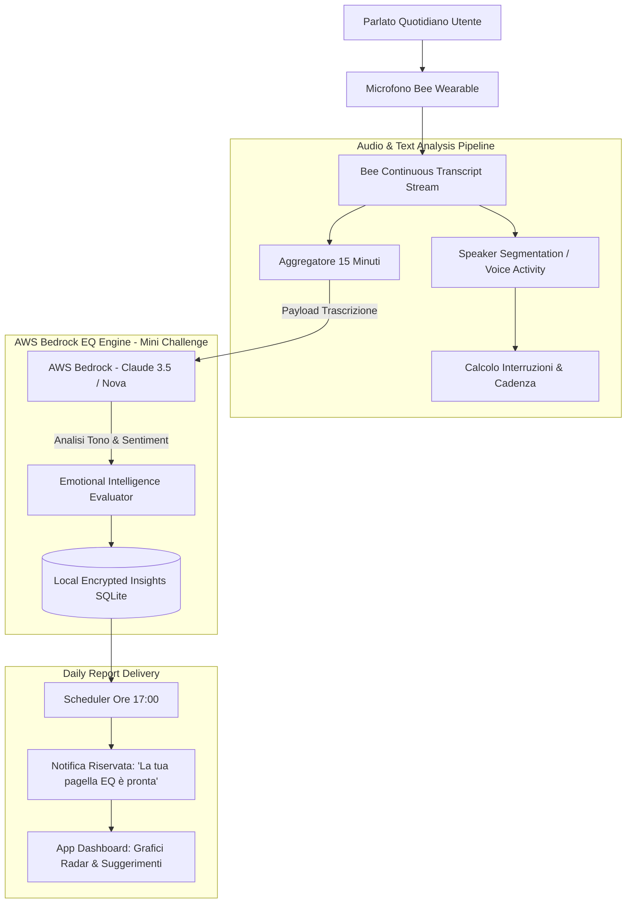

# 🪞 The "Tone-Deafness" Mirror

> **Track:** Bee (Wearable AI / Quantified Self & EQ)  
> **Mini-Challenge Eleggibile:** AWS Builder ($5.000 cash + $5.000 AWS credits)  
> **Target Device:** Bee Wearable / Apple Watch  
> **Tagline:** *"Il tuo coach invisibile di intelligenza emotiva. Renditi conto di come parli prima che sia troppo tardi."*

---

## 1. Visione & Valore Unico

### Il Problema Reale
Molte persone rovinano inavvertitamente carriere, relazioni amorose e amicizie a causa di **"punti ciechi comunicativi"**: usano toni passivo-aggressivi, alzano la voce senza accorgersene quando sono stressati, interrompono costantemente gli altri interlocutori o usano intercalari condiscendenti (*"Come ti ho già detto tre volte..."*, *"È ovvio che..."*). 
Nessuno dei colleghi o amici osa dirglielo in faccia per evitare conflitti. L'individuo rimane così all'oscuro del proprio impatto negativo sugli altri.

### La Soluzione "Clever"
**The Tone-Deafness Mirror** è un vero e proprio specchio per l'intelligenza emotiva (EQ):
1. Bee ascolta passivamente l'audio durante la giornata, isolando il canale vocale dell'utente.
2. Analizza in tempo reale tre vettori:
   * **Sentiment & Lessico:** Identificazione di frasi tossiche, condiscendenti o passive-aggressive.
   * **Dinamica Conversazionale (Interruzioni):** Calcolo di quante volte l'utente ha interrotto l'interlocutore prima che finisse di parlare.
   * **Prosodia & Volume:** Rilevamento di picchi di volume vocale e tensione acustica durante i meeting.
3. Alle **17:00 di ogni giorno lavorativo**, Bee recapita una **"Pagella di Empatia" confidenziale e privata** sullo smartphone o smartwatch:
   > 📊 **Punteggio Empatia di Oggi:** 6.4/10  
   > ⚠️ **Interruzioni rilevate:** 12 volte (Picco alle 14:30 durante la riunione commerciale)  
   > 🗣️ **Frase più condiscendente:** *"Ovviamente non hai letto l'email"*  
   > 💡 **Consiglio del giorno:** *"Prova ad aspettare 2 secondi di silenzio prima di replicare nelle discussioni tese."*

---

## 2. Allineamento con i Criteri dei Giudici Amazon

| Criterio Ufficiale | Come lo soddisfa Tone-Deafness Mirror |
| :--- | :--- |
| **Tech Implementation (25%)** | Analisi del parlato tramite **Bee CLI / Bee-Skill**, classificazione sentiment e analisi prosodica con aggregazione dei dati a intervalli temporali. |
| **Design & Riservatezza (25%)** | Esperienza confidenziale, non giudicante e costruttiva. Grafici chiari sull'andamento dell'umore e della serenità comunicativa settimanale. |
| **Potential Impact (25%)** | Strumento rivoluzionario per manager, venditori, coppie, e chiunque voglia sviluppare leadership ed empatia. |
| **Quality of Idea (25%)** | Le regole ufficiali dell'Hackathon citano testualmente per Bee: *"Creative: advance use of the facts and insights capabilities, real time functionality, **self improvement workflows**"*. Tone-Deafness Mirror è l'archetipo esatto del workflow di self-improvement. |

---

## 3. Architettura Tecnica & Stack

### Componenti Software
* **Bee Stream Ingestion:** Cattura transcript via `bee-cli stream`.
* **Calcolo Dinamico delle Interruzioni:** Quando la trascrizione rileva sovrapposizioni o stacchi ravvicinati (<300ms) tra speech di altri e presa di parola dell'utente.
* **AWS Bedrock EQ Engine:** Analizza i segmenti di conversazione per individuare bias linguistici:
  * Pattern condiscendenti (*"Non è difficile da capire"*)
  * Frasi passive-aggressive (*"Fai come vuoi tanto..."*)
  * Feedback positivi (*"Ottima idea, costruiamo su questo"*)
* **Privacy Vault:** Crittografia locale AES-256 dei report; nessuna memorizzazione permanente dell'audio vocale.

---

## 4. Nuove Funzionalità ad Alto Impatto

1. **"Haptic Live Nudge" (Il pizzicotto segreto):** Se durante una riunione inizi a parlare sopra gli altri per più di 3 volte di fila o il volume supera gli 85 dB, Bee emette una silenziosa, impercettibile vibrazione al polso per ricordarti di respirare e ascoltare.
2. **"Conflict De-escalation Advice":** Se rileva una lite domestica o lavorativa accesa, genera immediatamente 3 frasi di de-escalation da usare: *"Riconosco che questo punto ti frustra, proviamo a ripartire dall'obiettivo comune"*.
3. **"Weekly Evolution Radar":** Radar chart settimanale che misura 5 parametri: Ascolto Attivo, Chiarezza, Serenità, Pazienza, Assertività positiva.

---

## 5. Criticità Tecniche & Strategie di Mitigazione

| Criticità / Rischio | Impatto | Strategia di Mitigazione Hackathon |
| :--- | :--- | :--- |
| **Privacy e percezione da "Grande Fratello"** | Alto | Mostrare che l'analisi è **100% per uso personale ed esclusivo dell'utente**. Nessun dato viene condiviso con terzi o datori di lavoro. |
| **Diarizzazione dell'interlocutore** | Medio | Bee è posizionato vicino alla bocca dell'utente: il volume della sua voce è nettamente superiore a quello altrui, rendendo banale distinguere chi parla tramite thresholds di ampiezza. |

---

## 6. Mini-Challenges & Bonus

* **AWS Builder:** Utilizzo di **Amazon Bedrock** con prompt specializzati in psicologia della comunicazione e PNL (Programmazione Neuro-Linguistica) per analizzare il tono e restituire coaching di livello professionale.
* **Friction Log:** Documentare come Bee gestisce il buffering delle trascrizioni prolungate e la latenza dei webhook.
