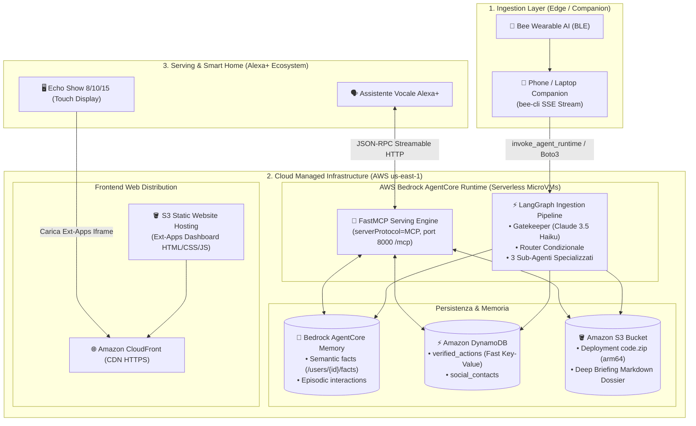

# ☁️ Architettura di Deployment Cloud & Infrastruttura (AWS & Edge)

> Questo documento specifica in dettaglio la **topologia di deployment**, l'**infrastruttura cloud su AWS** e la ripartizione dei carichi tra componenti **Edge (wearable bridge)**, **Managed Serverless (AWS Bedrock AgentCore Runtime & Memory)** e **Serving Layer (Alexa+ MCP & Echo Show Ext-Apps)** per il progetto **EXAMEN**.

---

## 🗺️ Topologia End-to-End di Deployment

L'architettura separa nettamente le responsabilità, massimizzando l'uso dei servizi gestiti di AWS Bedrock per garantire scalabilità a zero costi fissi e latenze minime:



---

## 🏗️ Dettaglio dei Componenti e Hosting

### 1. Ingestion Bridge (Edge / Companion)
* **Ruolo:** Raccoglie i dati audio e le trascrizioni dal dispositivo indossabile Bee e alimenta il buffer di scremaggio.
* **Come funziona:**
  - Il dispositivo Bee trasmette l'audio crittografato via Bluetooth Low Energy all'app Bee (iOS/Android).
  - L'app invia il flusso alle API cloud di Bee.
  - Il client [`resources/bee-cli/`](../resources/bee-cli/) si aggancia allo stream SSE (`bee.sse.streamJson({ types: ["new-utterance"] })`).
* **Dove viene eseguito:**
  - **In Fase di Sviluppo & Demo Hackathon:** Come demone locale eseguito sul laptop o come script Python/Node bridge.
  - **In Produzione Continua h24:** Come micro-container serverless (es. su **AWS App Runner** o istanza **EC2 t4g.nano**) sempre connesso all'account Bee dell'utente.
* **Interfaccia verso AWS:** Invoca l'endpoint AgentCore tramite il client data-plane di boto3:
  ```python
  import boto3
  data_client = boto3.client("bedrock-agentcore", region_name="us-east-1")
  response = data_client.invoke_agent_runtime(
      agentRuntimeArn="arn:aws:bedrock-agentcore:...:runtime/examen_pipeline",
      payload=json.dumps({"transcript_chunk": buffer_text, "timestamp": now_iso})
  )
  ```

---

### 2. Processing Pipeline: AWS Bedrock AgentCore Runtime (Managed)
* **Ruolo:** Esegue l'harness **LangGraph** (Gatekeeper $\to$ Router $\to$ Sub-Agenti di estrazione e Deep Research).
* **Caratteristiche di Hosting:**
  - **Ambiente:** MicroVM dedicate su architettura Graviton (arm64), completamente isolate e serverless.
  - **Lifecycle:** Scala automaticamente a zero quando non c'è parlato utile da elaborare; supporta esecuzioni estese fino a 8 ore per i task complessi di web research.
  - **Protocollo:** `serverProtocol="HTTP"`, esposto su porta 8080 (`/invocations`) tramite `BedrockAgentCoreApp`.
* **Packaging & Deployment:**
  - Le dipendenze compilate per arm64 (`aarch64-manylinux2014`) vengono scaricate tramite `uv`.
  - Il pacchetto `code.zip` viene caricato su un bucket S3.
  - Il runtime viene registrato tramite il control-plane di boto3:
    ```python
    control_client = boto3.client("bedrock-agentcore-control", region_name="us-east-1")
    control_client.create_agent_runtime(
        agentRuntimeName="examen_pipeline",
        agentRuntimeArtifact={
            "codeConfiguration": {
                "code": {"s3": {"bucket": "examen-artifacts", "prefix": "runtimes/pipeline.zip"}},
                "runtime": "PYTHON_3_12",
                "entryPoint": ["main.py"]
            }
        },
        roleArn=role_arn,
        networkConfiguration={"networkMode": "PUBLIC"}
    )
    ```

---

### 3. Persistenza & Memoria Multi-Tier

L'architettura adotta una combinazione strategica di 3 servizi AWS per coprire ogni esigenza informativa:

| Servizio Storage | Tipologia Dati | Scopo Specifico in EXAMEN |
| :--- | :--- | :--- |
| **AWS Bedrock AgentCore Memory** | Memoria Semantica & Episodica | Servizio nativo managed di AgentCore. Memorizza entità relazionali e fatti estratti (`/users/{actorId}/facts/`) ed episodi di conversazione, consentendo interrogazioni semantiche proattive. |
| **Amazon DynamoDB** | Database NoSQL ultra-rapido ($<20\text{ ms}$) | Tabella `verified_actions` indicizzata per `action_type` e `timestamp`. Consente all'MCP Server di rispondere in un battito di ciglia ad Alexa (*"Ho staccato il ferro?"*). |
| **Amazon S3** | Object Storage ad alta durabilità | 1. Hosting degli zip di deployment di AgentCore Runtime.<br>2. Salvataggio dei dossier approfonditi e report markdown generati dal modulo Deep Topic Research. |

---

### 4. Serving Layer: Alexa+ MCP Server
* **Ruolo:** Rispondere alle interrogazioni vocali di Alexa+ esponendo i tool di consultazione memoria.
* **Capacità Nativa di AgentCore:**
  Come documentato nei sample ufficiali (`agentcore-samples/01-features/02-host-your-agent/01-runtime/02-hosting-tools`), **AgentCore Runtime può ospitare direttamente server MCP**:
  - `serverProtocol="MCP"`
  - FastMCP su porta `8000` con path `/mcp` e trasporto `streamable-http`.
* **Integrazione con Alexa+:**
  - Alexa+ richiede un endpoint HTTPS pubblico per dialogare via JSON-RPC 2.0.
  - **In Locale / Test:** Server FastMCP locale esposto ad Alexa tramite **Cloudflare Tunnel** (`https://examen-mcp.yourdomain.com/mcp`).
  - **In Cloud AWS:** Runtime AgentCore MCP associato ad **AgentCore Gateway**, oppure **AWS Lambda Function URL** / **AWS App Runner** per esporre direttamente l'endpoint senza autenticazione SigV4 di basso livello.

---

### 5. Echo Show Visual UI (Ext-Apps Iframe SDK)
* **Ruolo:** Visualizzare dashboard interattive, schede relazionali e dossier tecnici sugli schermi di Echo Show 8, 10 e 15.
* **Stack:** Single Page Application statica ultra-reattiva (HTML5, modern Vanilla CSS con Dark Mode nativo, JavaScript ES6+).
* **Hosting:**
  - **Bucket S3** per l'archiviazione dei file statici (`index.html`, `app.css`, `app.js`, icone SVG).
  - **Amazon CloudFront** come Content Delivery Network (CDN) globale con certificato SSL automatico (HTTPS obbligatorio per l'iframe di Alexa Ext-Apps).
  - Questo garantisce caricamenti istantanei su Echo Show a costo quasi nullo.

---

## 🔄 Confronto Fasi: Sviluppo Locale vs Cloud Deployment

Per garantire rapidità di iterazione durante l'hackathon senza blocchi infrastrutturali:

| Componente | 💻 Fase 1: Sviluppo Rapido Locale | ☁️ Fase 2: Cloud Submission (AWS & AgentCore) |
| :--- | :--- | :--- |
| **Audio Ingestion** | Trascrizioni mockate o `bee-cli` su macchina locale | Bridge locale o micro-container su AWS App Runner |
| **Harness LangGraph** | Esecuzione locale con `langchain-aws` verso Bedrock API | **AWS Bedrock AgentCore Runtime** (microVM arm64) |
| **Gatekeeper & Modelli** | AWS Bedrock (`Claude 3.5 Haiku` & `Sonnet`) | AWS Bedrock (`Claude 3.5 Haiku` & `Sonnet`) |
| **Database & Memoria** | SQLite locale (`examen.db`) con indice FTS5 | **AgentCore Memory** + **DynamoDB** + **S3** |
| **Server MCP per Alexa+** | FastMCP locale su porta 8000 + Cloudflare Tunnel | **AgentCore Runtime (MCP Protocol)** o Lambda Function URL |
| **Echo Show Ext-Apps UI** | Web server locale (`localhost:3000`) via Tunnel | **S3 Static Website + Amazon CloudFront CDN** |

---

## 🏆 Perché Questa Architettura Vince la Mini-Challenge AWS Builder

La giuria della **AWS Builder Challenge ($5.000 cash + $5.000 crediti)** valuta specificamente:
1. **Adozione dei Servizi Bedrock AgentCore di Ultima Generazione:**
   - Non ci limitiamo a fare una chiamata API a Bedrock, ma adottiamo sia **AgentCore Runtime** (per hosting del grafo) sia **AgentCore Memory** (per la conservazione contestuale a lungo termine).
2. **Multi-Model Tiering Intelligente:**
   - Ottimizzazione dei costi di inferenza con modelli ultraleggeri (*Haiku/Nova Micro*) per il Gatekeeper e modelli di ragionamento (*Sonnet/Nova Pro*) per il Deep Research.
3. **Resilienza e Serverless First:**
   - Nessun server monolitico da manutenere: l'intero stack cloud scala a zero in assenza di traffico e scala orizzontalmente in modo automatico.
