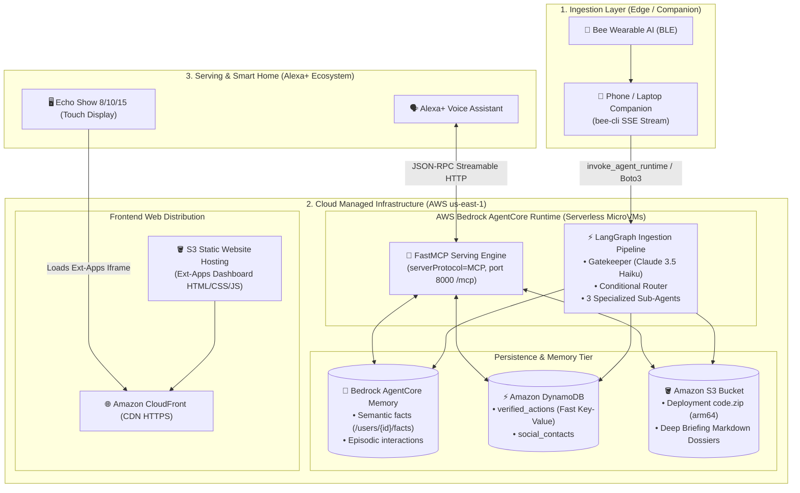

# ☁️ Cloud Deployment Architecture & Infrastructure (AWS & Edge)

> This document details the **deployment topology**, **AWS cloud infrastructure**, and division of responsibilities across **Edge (wearable bridge)**, **Managed Serverless (AWS Bedrock AgentCore Runtime & Memory)**, and **Serving Layer (Alexa+ MCP & Echo Show Ext-Apps)** for **EXAMEN**.

---

## 🗺️ End-to-End Deployment Topology

The architecture enforces strict separation of concerns, maximizing AWS Bedrock managed services to achieve zero-idle-cost serverless scalability and minimal latency:



---

## 🏗️ Components & Hosting Specifications

### 1. Ingestion Bridge (Edge / Companion)
* **Role:** Streams audio transcripts from the Bee wearable device and feeds the sliding-window screening buffer.
* **Mechanism:**
  - The Bee device streams encrypted audio via BLE to the Bee mobile app.
  - The companion client in [`resources/bee-cli/`](../resources/bee-cli/) subscribes to the Server-Sent Events stream (`bee.sse.streamJson({ types: ["new-utterance"] })`).
* **Hosting Target:**
  - **Local Development & Demo:** Runs locally on the developer's laptop as a background script.
  - **24/7 Cloud Production:** Deployed as a lightweight container (e.g. **AWS App Runner** or an **EC2 t4g.nano** micro-instance) connected to the user's Bee account.
* **AWS Dispatch:** Calls the AgentCore data-plane endpoint via boto3:
  ```python
  import boto3
  data_client = boto3.client("bedrock-agentcore", region_name="us-east-1")
  response = data_client.invoke_agent_runtime(
      agentRuntimeArn="arn:aws:bedrock-agentcore:...:runtime/examen_pipeline",
      payload=json.dumps({"transcript_chunk": buffer_text, "timestamp": now_iso})
  )
  ```

---

### 2. Processing Pipeline: AWS Bedrock AgentCore Runtime (Managed)
* **Role:** Executes the **LangGraph** state graph (Gatekeeper $\to$ Router $\to$ Extraction & Deep Research sub-agents).
* **Hosting Characteristics:**
  - **Environment:** Dedicated microVMs on AWS Graviton (arm64), fully isolated and serverless.
  - **Lifecycle:** Scales automatically to zero when idle; supports up to 8 hours execution for deep research tasks.
  - **Protocol:** `serverProtocol="HTTP"`, listening on port 8080 (`/invocations`) via `BedrockAgentCoreApp`.
* **Packaging & Deployment:**
  - arm64 wheels (`aarch64-manylinux2014`) downloaded via `uv`.
  - Compressed into `code.zip` and uploaded to an S3 bucket.
  - Runtime instantiated using boto3 control-plane:
    ```python
    control_client = boto3.client("bedrock-agentcore-control", region_name="us-east-1")
    control_client.create_agent_runtime(
        agentRuntimeName="examen_pipeline",
        agentRuntimeArtifact={
            "codeConfiguration": {
                "code": {"s3": {"bucket": "examen-artifacts", "prefix": "runtimes/pipeline.zip"}},
                "runtime": "PYTHON_3_12",
                "entryPoint": ["main.py"]
            }
        },
        roleArn=role_arn,
        networkConfiguration={"networkMode": "PUBLIC"}
    )
    ```

---

### 3. Multi-Tier Persistence & Memory

Combines three AWS storage services to address distinct query patterns:

| Storage Service | Data Category | Specific Role in EXAMEN |
| :--- | :--- | :--- |
| **AWS Bedrock AgentCore Memory** | Semantic & Episodic Memory | Fully managed AgentCore native memory service. Stores extracted relational entities (`/users/{actorId}/facts/`) and conversation episodes for semantic retrieval. |
| **Amazon DynamoDB** | Ultra-Low Latency NoSQL ($<20\text{ ms}$) | Table `verified_actions` keyed on `action_type` and `timestamp`. Powers instantaneous Alexa responses (*"Did I unplug the iron?"*). |
| **Amazon S3** | Durable Object Storage | 1. Hosting code deployment zip artifacts for AgentCore.<br>2. Archiving synthesized markdown briefings and technical research reports. |

---

### 4. Serving Layer: Alexa+ MCP Server
* **Role:** Serves voice inquiries from Alexa+ by exposing memory query tools.
* **Native AgentCore Capability:**
  As documented in official samples (`agentcore-samples/01-features/02-host-your-agent/01-runtime/02-hosting-tools`), **AgentCore Runtime can natively host MCP servers**:
  - `serverProtocol="MCP"`
  - FastMCP listening on port `8000` with path `/mcp` over `streamable-http`.
* **Alexa+ Integration:**
  - Requires a public HTTPS endpoint for JSON-RPC 2.0.
  - **Local Development:** FastMCP on `localhost:8000` tunneled via Cloudflare Tunnel.
  - **AWS Production:** AgentCore MCP Runtime linked to **AgentCore Gateway**, or an **AWS Lambda Function URL** / **AWS App Runner** proxy.

---

### 5. Echo Show Visual UI (Ext-Apps Iframe SDK)
* **Role:** Visualizes interactive status dashboards, contact rolodexes, and research dossiers on Echo Show displays (8, 10, 15).
* **Stack:** Static Single Page Application (HTML5, modern Vanilla CSS Dark Mode, ES6+ JS).
* **Hosting:**
  - **Amazon S3** for static asset storage (`index.html`, `styles.css`, `app.js`, SVG icons).
  - **Amazon CloudFront** as global CDN delivering HTTPS (mandatory for Alexa Ext-Apps iframes).

---

## 🔄 Development Stages: Local Rapid Prototyping vs Cloud Production

| Component | 💻 Stage 1: Local Rapid Dev | ☁️ Stage 2: Cloud Submission (AWS & AgentCore) |
| :--- | :--- | :--- |
| **Audio Ingestion** | Mock audio transcripts / local `bee-cli` | Local companion or AWS App Runner container |
| **LangGraph Harness** | Local Python execution via `langchain-aws` | **AWS Bedrock AgentCore Runtime** (microVM arm64) |
| **Gatekeeper & Models** | AWS Bedrock (`Claude 3.5 Haiku` & `Sonnet`) | AWS Bedrock (`Claude 3.5 Haiku` & `Sonnet`) |
| **Database & Memory** | Local SQLite (`examen.db`) with FTS5 | **AgentCore Memory** + **DynamoDB** + **S3** |
| **Alexa+ MCP Server** | FastMCP on port 8000 + Cloudflare Tunnel | **AgentCore Runtime (MCP Protocol)** / Lambda URL |
| **Echo Show Ext-Apps UI** | Local web server (`localhost:3000`) via Tunnel | **S3 Static Website + Amazon CloudFront CDN** |

---

## 🏆 Winning the AWS Builder Mini-Challenge

1. **Holistic Bedrock AgentCore Stack Adoption:**
   Leverages both **AgentCore Runtime** (serverless microVM execution) and **AgentCore Memory** (long-term semantic namespaces).
2. **Cost-Optimized Multi-Model Tiering:**
   Lightweight models (*Haiku / Nova Micro*) for screening and reasoning models (*Sonnet / Nova Pro*) for deep research.
3. **Serverless-First Design:**
   Zero idle costs, automatic scaling, and enterprise-grade resilience.
