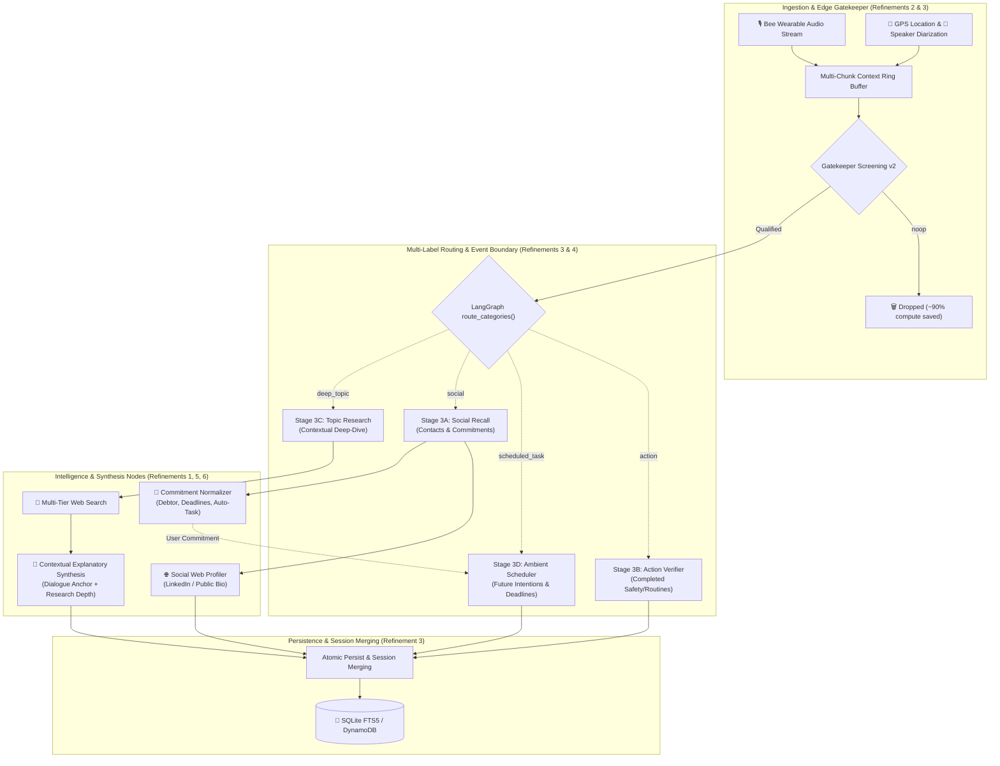

# 🚀 EXAMEN Pipeline Refinements & Evolution Roadmap

> **Document Status:** Architectural Specification  
> **Source Task:** [Next_steps.txt](file:///home/deggio/Desktop/coding/hackathon/amazon_challenge/Next_steps.txt)  
> **Execution Tracking:** See the full [ROADMAP.md](file:///home/deggio/Desktop/coding/hackathon/amazon_challenge/docs/next_steps/ROADMAP.md) for milestone order and progress.  
> **Scope:** High-impact enhancements to ambient screening, multi-modal ingestion, contextual synthesis, and relational intelligence.

---

## 🎯 Vision: From Speech Recognition to Ambient Executive Intelligence

**EXAMEN** (*from Latin "exāmen": swarm of bees & careful examination*) has established a proven baseline:
1. Low-cost edge screening via the **Semantic Gatekeeper** dropping ~90%+ irrelevant chatter.
2. Multi-label fan-out routing in **LangGraph**.
3. Durable context storage with **SQLite FTS5**.
4. Multi-modal serving to **Alexa+ on Echo Show** via **FastMCP** (Streamable-HTTP).

While the foundational pipeline operates reliably (89/89 tests passing), real-world wearable audio from the **Bee Wearable** presents nuanced conversational patterns that demand six targeted architectural refinements tracked in the [Evolution Roadmap](file:///home/deggio/Desktop/coding/hackathon/amazon_challenge/docs/next_steps/ROADMAP.md):



---

## 📑 The 6 Pipeline Refinement Areas

The refinements defined in [Next_steps.txt](file:///home/deggio/Desktop/coding/hackathon/amazon_challenge/Next_steps.txt) are organized into six dedicated specification documents:

| # | Topic | Document | Primary Goal |
|---|---|---|---|
| **1** | **Contextual Deep Topic Synthesis** | [01_deep_topic_contextual_synthesis.md](file:///home/deggio/Desktop/coding/hackathon/amazon_challenge/docs/next_steps/01_deep_topic_contextual_synthesis.md) | Generate rich, educational, and technical explanatory sections that use web research to unpack concepts discussed in meetings or lectures, tailored to the topic's nature. |
| **2** | **Gatekeeper Context & Multimodal Telemetry** | [02_gatekeeper_context_and_multimodal_telemetry.md](file:///home/deggio/Desktop/coding/hackathon/amazon_challenge/docs/next_steps/02_gatekeeper_context_and_multimodal_telemetry.md) | Implement multi-chunk historical context forwarding on positive triggers, integrating Bee GPS location data and asynchronous speaker diarization. |
| **3** | **Session Merging & Micro-Event Splitting** | [03_session_merging_and_micro_event_splitting.md](file:///home/deggio/Desktop/coding/hackathon/amazon_challenge/docs/next_steps/03_session_merging_and_micro_event_splitting.md) | Aggregate long meetings/lectures spanning multiple chunks into a unified session dossier, while splitting nested actions/contacts occurring during discussions. |
| **4** | **Ambient Scheduled Task Extraction** | [04_ambient_scheduled_tasks.md](file:///home/deggio/Desktop/coding/hackathon/amazon_challenge/docs/next_steps/04_ambient_scheduled_tasks.md) | Extract spoken future intentions ("I need to call Dr. Smith at 3 PM") into calendar-ready planned tasks, distinguishing them from manual entries. |
| **5** | **Structured Social Commitments** | [05_structured_social_commitments.md](file:///home/deggio/Desktop/coding/hackathon/amazon_challenge/docs/next_steps/05_structured_social_commitments.md) | Parse bilateral promises (debtor, deadline, action) and automatically schedule tasks when the user makes a commitment to another person. |
| **6** | **Social Contact Web Enrichment** | [06_social_web_enrichment.md](file:///home/deggio/Desktop/coding/hackathon/amazon_challenge/docs/next_steps/06_social_web_enrichment.md) | Enrich newly encountered contacts with autonomous public web research (LinkedIn role, professional bio, company domain). |

---

## 🧩 Architectural Contract Evolution

### 1. Schema Extensions (`src/core/schemas.py`)

To support these capabilities without breaking existing persistence or MCP tools, data models will evolve with backward-compatible defaults:

```python
# PlannedTask: Distinguish origin of scheduling
class PlannedTask(BaseModel):
    id: Optional[str] = Field(default=None)
    title: str
    domain: Literal["safety", "routine", "work_task"] = "routine"
    scheduled_time: Optional[str] = None
    recurrence: str = "none"
    status: Literal["pending", "completed"] = "pending"
    completed_at: Optional[str] = None
    verified_action_id: Optional[str] = None
    created_at: str = Field(default_factory=lambda: datetime.now().isoformat())
    # NEW FIELDS:
    origin: Literal["manual", "ambient_voice", "social_commitment"] = "manual"
    raw_statement: Optional[str] = None
    confidence: float = 1.0

# SocialEntity: Structured commitments & web enrichment
class SocialCommitment(BaseModel):
    debtor: Literal["user", "contact"]  # Who made the promise
    description: str                    # What was promised
    due_date_text: Optional[str] = None # e.g., "tomorrow morning", "by Friday"
    normalized_deadline: Optional[str] = None  # ISO timestamp
    auto_schedule: bool = False         # Triggers creation of PlannedTask

class SocialEntity(BaseModel):
    id: Optional[str] = Field(default=None)
    person_name: str
    company_or_role: Optional[str] = None
    contact_info: Optional[str] = None
    key_topics: List[str] = Field(default_factory=list)
    commitments: List[SocialCommitment] = Field(default_factory=list)
    timestamp: str = Field(default_factory=lambda: datetime.now().isoformat())
    # NEW FIELDS:
    public_bio: Optional[str] = None    # Enriched from LinkedIn/Web
    web_sources: List[str] = Field(default_factory=list)
    meeting_location: Optional[str] = None  # GPS reverse geocoded

# BriefingReport: Contextual explanatory synthesis
class BriefingReport(BaseModel):
    id: Optional[str] = Field(default=None)
    topic_title: str
    context_type: Literal["bug", "feature_discussion", "tech_stack", "academic_lecture", "general_meeting"]
    session_id: Optional[str] = None    # Links chunks from the same meeting
    executive_summary: List[str] = Field(default_factory=list)
    # NEW FIELD: Comprehensive explanatory synthesis
    explanatory_synthesis: str = Field(
        default="",
        description="Authoritative, educational synthesis unpacking concepts using web research tailored to the topic context."
    )
    deep_dive_markdown: str = ""
    web_sources: List[str] = Field(default_factory=list)
    action_items: List[str] = Field(default_factory=list)
    created_at: str = Field(default_factory=lambda: datetime.now().isoformat())
```

---

## 🛡️ Non-Regression & Quality Commitments

All refinements follow strict engineering constraints:
1. **100% English Codebase**: Code, comments, schemas, and markdown documentation strictly in English.
2. **Backward Compatibility**: Existing database tables in `examen.db` and FastMCP endpoints must continue operating without breaking changes.
3. **Test-Driven Rollout**: Every enhancement will be paired with comprehensive unit and live mock tests in `tests/`.
4. **Dual-Provider Resilience**: Compatible with both AWS Bedrock native Converse API (`nvidia.nemotron-super-3-120b`) and Bedrock Mantle.
