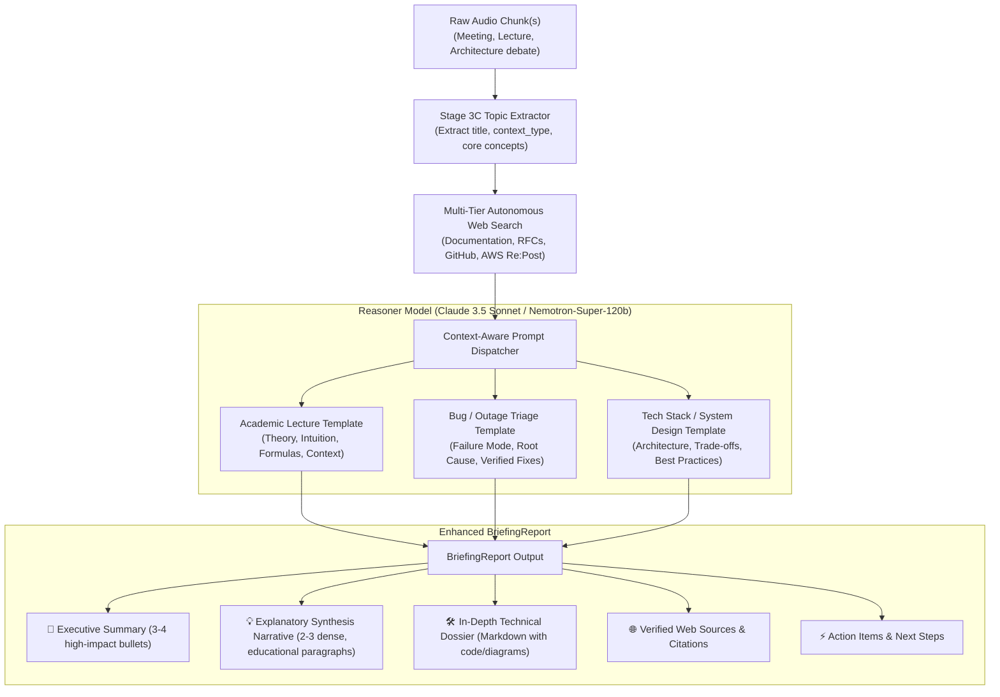

# 📚 Deep Topic: Contextual Explanatory Synthesis

> **Reference Item:** Point 1 from `Next_steps.txt`
> **Target Module:** `src/pipeline/nodes/topic_research.py`
> **Schema Contract:** `src/core/schemas.py::BriefingReport`

---

## 🎯 The Core Problem & User Requirement

In the current implementation of `src/pipeline/nodes/topic_research.py`:
1. The **Topic Extractor** identifies the topic title, context type, and 1-2 focused search queries.
2. The **Web Search Engine** retrieves authoritative documentation and articles via DuckDuckGo / direct HTML scraping.
3. The **Reasoner Synthesizer** outputs:
   - `executive_summary`: 3-4 concise bullet points.
   - `deep_dive_markdown`: Technical architectural documentation.
   - `web_sources`: A list of consulted URLs.
   - `action_items`: Follow-up recommendations.

### The Limitation
While the web sources retrieved are accurate, the generated report frequently jumps straight into generic bullet points or broad definitions. It lacks an **explanatory, contextual narrative** that bridges what was discussed in the room with the deep knowledge retrieved from the web.

### The Exact Requirement
As emphasized by the user:
> *"The point is not to repeat what the participants said verbatim. Rather, it must be an explanatory section that deeply unpacks and explains the discussed themes using the discovered web sources — behaving as an intelligent executive/academic assistant that prepares a ready-to-use report after a meeting or lecture, understanding the topic to determine how much, in what manner, and what specifically to delve into."*

The report must be **immediately useful, comfortable to read, and educational**:
- If the session was an **academic lecture**, it must break down theoretical theorems, provide intuitive analogies, and summarize the underlying mathematical or conceptual models.
- If it was a **system outage or bug triage**, it must explain the failure mechanisms, root causes documented across GitHub issues/AWS forums, and actionable mitigation paths.
- If it was an **architectural debate**, it must articulate trade-offs, scalability constraints, and state-of-the-art engineering patterns.

---

## 🏗️ Architectural Design & Synthesis Engine



---

## 📝 Schema Enhancement (`src/core/schemas.py`)

We enhance `BriefingReport` by adding `explanatory_synthesis` as a first-class citizen alongside `executive_summary`:

```python
class BriefingReport(BaseModel):
    id: Optional[str] = Field(default=None, description="Unique briefing identifier.")
    topic_title: str = Field(description="Title of explored topic.")
    context_type: Literal[
        "bug",
        "feature_discussion",
        "tech_stack",
        "academic_lecture",
        "system_incident",
        "general_meeting"
    ] = Field(description="Context classification driving synthesis depth.")
    
    # Quick visual summary for Echo Show cards
    executive_summary: List[str] = Field(
        default_factory=list,
        description="Executive summary in 3-4 bullet points."
    )
    
    # NEW: The deep explanatory narrative bridging dialogue concepts and web intelligence
    explanatory_synthesis: str = Field(
        default="",
        description=(
            "A cohesive, authoritative narrative (2-3 paragraphs) that explains and deep dives "
            "into the concepts discussed using findings from retrieved web documentation. "
            "Tailored to be educational, practical, and immediately usable."
        )
    )
    
    deep_dive_markdown: str = Field(
        default="",
        description="Full technical dossier with architectural definitions, code snippets, and CLI commands."
    )
    web_sources: List[str] = Field(
        default_factory=list,
        description="Consulted external URLs and documentation citations."
    )
    action_items: List[str] = Field(
        default_factory=list,
        description="Actionable next steps or practical takeaways."
    )
    created_at: str = Field(
        default_factory=lambda: datetime.now().isoformat()
    )
```

---

## 🧠 Dynamic Prompt Engineering: Adaptive Depth

The synthesizer prompt must instruct the model to adapt its depth and pedagogical tone based on `context_type`:

```python
SYNTHESIZER_SYSTEM_PROMPT = """You are the Senior Technical Research Synthesizer and Executive Knowledge Assistant for the EXAMEN wearable AI engine.
Your mission is to compile an authoritative, high-density briefing report after an ambient meeting, technical discussion, or academic lecture.

CRITICAL INSTRUCTION FOR explanatory_synthesis:
Do NOT simply repeat conversational dialogue or transcripts.
Instead, act as a world-class domain expert. Synthesize a 2-3 paragraph cohesive, educational narrative that deeply explains and unpacks the core themes discussed, using the authoritative web search findings to fill all technical gaps.

ADAPT DEPTH AND FOCUS BASED ON CONTEXT TYPE:
1. When context_type is "academic_lecture":
   - Explain the core theoretical foundations, key theorems, and conceptual models.
   - Provide intuitive analogies and practical illustrations so the reader thoroughly understands the mechanism.
   - Clarify academic terminology and historical or scientific context.

2. When context_type is "bug" or "system_incident":
   - Explain the underlying technical failure mode (memory leak, race condition, network timeout, cold-start).
   - Unpack why the error occurs in the software architecture based on official documentation and community findings.
   - Outline verified workarounds, configuration flags, or patch recommendations.

3. When context_type is "tech_stack" or "feature_discussion":
   - Detail the architectural trade-offs, scalability bottlenecks, and operational trade-offs.
   - Explain standard best practices, recommended libraries, and standard deployment patterns.

4. When context_type is "general_meeting":
   - Clarify industry concepts, strategic definitions, and the practical implications of decisions considered.

OUTPUT RULES:
- Write explanatory_synthesis with dense, professional clarity.
- Structure deep_dive_markdown with clear headings, code snippets, and direct citations.
- Include 3-4 high-impact bullets in executive_summary.
- Provide concrete, pragmatic action_items.
"""
```

---

## 💻 Presentation on Echo Show & Web UI

### 1. Echo Show Card (`DEEP_BRIEFING_VIEWER`)
On Echo Show (via `ext-apps`):
- **Hero Title & Category Tag**: e.g., *"LangGraph Bedrock Latency Analysis"* `[BUG / RUNTIME]`.
- **Explanatory Synthesis Block**: Displayed in a highlighted card with a clean, readable serif/sans typography, allowing the user to glance at the explanation without scrolling through hundreds of lines of code.
- **Web Sources Carousel**: Interactive badges linking to consulted documentation.
- **Alexa Spoken Summary**:
  *"I've prepared your briefing on LangGraph Bedrock Latency. Based on AWS and LangChain documentation, the bottleneck is caused by client cold-starts on the Converse API after idle periods. I've noted 4 mitigation steps and 6 web references on your screen."*

### 2. Desktop Web UI (`src/web_ui/`)
- Collapsible briefing cards displaying the **Explanatory Synthesis** right under the executive summary.
- Markdown viewer rendering the technical breakdown, complete with copy-to-clipboard code snippets and external citations.

---

## 🧪 Verification & Acceptance Criteria

1. **Information Density Test**: An audio chunk discussing a niche topic (e.g., *"Distributed consensus with Raft and etcd"*) must produce an `explanatory_synthesis` explaining quorum requirements, split-brain mitigation, and log compaction using verified web sources.
2. **Context Adaptation Test**: A bug discussion on Bedrock API latency must produce an explanatory synthesis explaining Time-to-First-Token (TTFT), connection pooling, and ConverseStream limitations.
3. **No-Hallucination Guard**: Citations in the synthesis must link directly to URLs present in `web_sources`.
