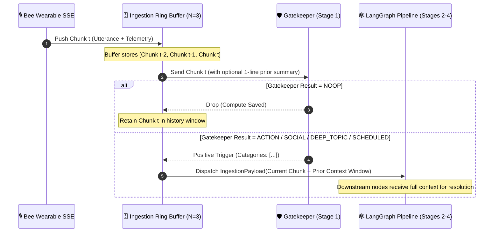

# 📡 Gatekeeper Context Window & Multimodal Telemetry

> **Document Status:** Architectural Specification  
> **Source Task:** `Next_steps.txt` (original task list, not in the repository) — Item 2  
> **Related Components:** [orchestrator.py](../../src/ingestion/orchestrator.py), [stream_convo.py](../../src/ingestion/stream_convo.py), [gatekeeper.py](../../src/ingestion/gatekeeper.py), [schemas.py](../../src/core/schemas.py)

---

## 1. Problem Statement & Challenges

In ambient wearable audio streaming (such as from the **Bee Wearable** device), real-world conversations and actions suffer from three critical boundary issues:

1. **Fragmented Pronoun & Context Dependencies:** Spoken dialogue is chunked into 15–30 second windows. An action or commitment often spans chunk boundaries:
   - *Chunk t-1:* "Can you please send me the Q3 financial audit report before tomorrow afternoon?"
   - *Chunk t:* "Sure, consider it done. I'll email it first thing in the morning."
   If Chunk $t$ is evaluated in complete isolation, the model does not know *what* was promised, *who* requested it, or what "it" refers to.
2. **Spatial Blindness:** Spoken sentences like "I just locked up and turned off the stove" gain immense verification validity when paired with wearable GPS telemetry indicating the user was at `Home` or is departing their residential coordinates.
3. **Asynchronous Speaker Diarization:** The Bee streaming backend emits `new-utterance` text events near real-time, but diarization labels (`speaker_0`, `speaker_1`, etc.) often arrive with a 2–5 second latency or through delayed `update-conversation` SSE events once server-side voice embeddings converge.

> **Reality check (2026-10-19, [10_bee_cli_reference.md](../10_bee_cli_reference.md) §7.3):** the real stream has no `speaker_N` labels and no `update-utterance` event. `new-utterance` carries no speaker at all; identity arrives ~1 s later as `tagged-utterance` (`person_first_name`, `person_id`, `speaker_score`), for about 22 % of utterances. The wearer is recognised by comparing `person_first_name` with `bee me`. See audit items C5/C6.

---

## 2. Ingestion Ring Buffer Architecture

To solve context fragmentation without inflating the cost of every Gatekeeper evaluation, EXAMEN implements a **Two-Tier Ring Buffer**:



### Cost vs. Accuracy Trade-Off Analysis

| Strategy | GK Input Token Load | LLM Cost Impact | Context Completeness for Downstream Nodes | Recommended |
|---|---|---|---|---|
| **A. Naive Sliding Window to GK** | ~600 tokens/eval (Chunks $t-2, t-1, t$) | +200% on every edge call | High | ❌ Too expensive for 90% dropped audio |
| **B. Isolated GK + Context Forwarding** | ~120 tokens/eval (Chunk $t$ only) | Baseline (minimal) | High (Prior chunks forwarded on trigger) | ⚠️ May miss split-phrases where Chunk $t$ is only "Yes, sure" |
| **C. Hybrid Anaphora GK + FIFO Context Forwarding** | ~180 tokens/eval (Chunk $t$ + 1-sentence rolling summary of prior 60s) | +25% edge cost | **Maximum** (Full verbatim history forwarded only to positive triggers) | ✅ **Selected Architecture** |

### Implementation Specification: `RingBufferIngestion`

```python
from collections import deque
from typing import List, Optional
from pydantic import BaseModel
from datetime import datetime

class UtteranceChunk(BaseModel):
    chunk_id: str
    conversation_uuid: str
    text: str
    speaker_id: Optional[str] = None
    timestamp: datetime
    location: Optional[dict] = None

class ContextRingBuffer:
    """FIFO rolling buffer retaining the last N chunks per active conversation."""
    
    def __init__(self, capacity: int = 4):
        self.capacity = capacity
        self.buffers: dict[str, deque[UtteranceChunk]] = {}
        
    def push(self, chunk: UtteranceChunk):
        conv_id = chunk.conversation_uuid or "default_session"
        if conv_id not in self.buffers:
            self.buffers[conv_id] = deque(maxlen=self.capacity)
        self.buffers[conv_id].append(chunk)
        
    def get_historical_context(self, conv_id: str, exclude_current: bool = True) -> List[UtteranceChunk]:
        buffer = self.buffers.get(conv_id, deque())
        items = list(buffer)
        if exclude_current and items:
            return items[:-1]
        return items

    def get_concatenated_context_text(self, conv_id: str) -> str:
        history = self.get_historical_context(conv_id, exclude_current=True)
        if not history:
            return ""
        lines = [f"[{h.speaker_id or 'Speaker'}]: {h.text}" for h in history]
        return "\n".join(lines)
```

---

## 3. Multimodal Telemetry Integration: Bee GPS & Semantic Places

The Bee Wearable emits periodic location telemetry over Server-Sent Events (SSE).

> **Reality check (2026-10-19, [10_bee_cli_reference.md](../10_bee_cli_reference.md) §6):** with the Apple Watch app **no `update-location` event was emitted** during a 35-minute conversation, and no Bee source exposes `horizontal_accuracy`. Locations are available from `bee locations current --json` (last fix + `is_recent`) and from each conversation's `primary_location`; `address` is a postal address, not a place name. Live chunks therefore have no location today (audit items C2–C4).

### 1. Ingestion of `update-location` Events

From `resources/bee-cli`, the SSE payload structure is:

```json
{
  "event": "update-location",
  "data": {
    "location": {
      "latitude": 37.774929,
      "longitude": -122.419416,
      "name": "Market St, San Francisco, CA",
      "horizontal_accuracy": 5.0
    }
  }
}
```

### 2. Schema Evolution for State & Context

We extend [ExamenState](../../src/core/schemas.py) and `IngestionPayload` to carry geospatial telemetry:

```python
class LocationTelemetry(BaseModel):
    latitude: float
    longitude: float
    place_name: Optional[str] = None
    semantic_zone: Optional[Literal["home", "work_office", "transit", "public_venue"]] = None
    accuracy_meters: Optional[float] = None
    captured_at: datetime = Field(default_factory=datetime.utcnow)
```

### 3. Spatial Grounding in LangGraph Nodes

Geospatial telemetry empowers downstream nodes:
- **`ActionVerifier` (Stage 3B):** A verified routine like `"locked front door"` or `"turned off stove"` is correlated with `semantic_zone == "home"`. If the user says "I just parked and locked the car", coordinates are stored as the parked vehicle location.
- **`TopicResearch` (Stage 3C):** If the location resolves to an academic campus or corporate conference center, the synthesis tone and entity disambiguation are primed for scholarly or enterprise contexts.
- **`SocialRecall` (Stage 3A):** Meeting someone at `place_name: "Starbucks on 4th"` automatically populates the `location_encountered` attribute in the social entity.

---

## 4. Handling Asynchronous Speaker Diarization

### The Latency Problem
Audio streaming from low-power BLE wearables requires instant edge transcription. Deep speaker diarization (clustering acoustic voice embeddings) runs on remote GPU clusters and can lag 1 to 4 seconds behind the initial text utterance.

```
Time (ms)  Event
-------------------------------------------------------------------------------------
t = 0ms    Audio packet received by Bee gateway
t = 450ms  SSE 'new-utterance': { "text": "I will deliver the slides by 5 PM" }
           (Speaker is UNKNOWN or 'speaker_pending')
t = 2800ms SSE 'update-utterance': { "utterance_id": 104, "speaker": "speaker_1" }
```

> **Observed instead:** `t ≈ +1 s` `tagged-utterance`: `{ "utterance_id": 104, "person_id": 7, "person_first_name": "Marco", "speaker_score": 0.8 }`. The dual-phase strategy below still applies, but it must be driven by `tagged-utterance`.

### Dual-Phase Diarization Strategy

1. **Short Ingestion Debounce (Configurable 500ms - 1500ms):**
   - For real-time streaming, the orchestrator introduces a 750ms buffer window before triggering LLM screening. If the diarization tag arrives within this window, it is bound immediately.
2. **Optimistic Processing with Retrospective Metadata Patching:**
   - If the Gatekeeper triggers before speaker diarization finishes, the LangGraph workflow executes with `speaker: "unknown_speaker"`.
   - When the `update-utterance` event arrives:
     - The orchestrator updates the record in the SQLite database (`verified_actions`, `social_entities`, or `session_briefings`) by matching the `utterance_id` or `chunk_id`.
3. **Primary User Voice ID Calibration:**
   - The primary user's voice signature is mapped to `speaker_role: "user"`.
   - Other speakers are tagged `speaker_role: "contact"` (`speaker_1`, `speaker_2`, etc.).
   - This distinction is vital for **Commitment Normalization** (determining whether the *user* promised something vs. the *contact* promised something).

---

## 5. End-to-End Orchestrator Ingestion Flow

```python
async def process_incoming_utterance(
    utterance_data: dict,
    latest_telemetry: LocationTelemetry,
    buffer: ContextRingBuffer,
    pipeline: LangGraphPipeline
):
    # 1. Instantiate chunk with telemetry
    chunk = UtteranceChunk(
        chunk_id=utterance_data["id"],
        conversation_uuid=utterance_data.get("conversation_uuid", "default"),
        text=utterance_data["text"],
        speaker_id=utterance_data.get("speaker"),
        timestamp=datetime.utcnow(),
        location=latest_telemetry.dict() if latest_telemetry else None
    )
    
    # 2. Append to ring buffer
    buffer.push(chunk)
    
    # 3. Formulate Gatekeeper payload
    # Current chunk + lightweight prior context
    historical_context = buffer.get_concatenated_context_text(chunk.conversation_uuid)
    
    # 4. Invoke Gatekeeper
    gk_result = await pipeline.gatekeeper.evaluate(
        current_text=chunk.text,
        prior_context=historical_context[-300:] if historical_context else None
    )
    
    if gk_result.is_noop():
        return  # Drop chunk (~90% filtered)
        
    # 5. On positive trigger: package full context for LangGraph execution
    state_input = {
        "text": chunk.text,
        "historical_context": historical_context,
        "categories": gk_result.categories,
        "location": chunk.location,
        "speaker": chunk.speaker_id,
        "conversation_uuid": chunk.conversation_uuid
    }
    
    await pipeline.run(state_input)
```

---

## 6. Testing & Validation Strategy

1. **Context Forwarding Unit Test (`test_ring_buffer_forwarding.py`):**
   - Inject 3 sequential chunks where Chunk 1 introduces an entity ("Dr. Harrison"), Chunk 2 introduces an action ("agreed to review the contract"), and Chunk 3 confirms ("Yes, do it").
   - Assert downstream `SocialRecall` receives the entire 3-chunk window.
2. **Telemetry Binding Test (`test_telemetry_attachment.py`):**
   - Stream an `update-location` event with GPS coordinates.
   - Send an action utterance ("I locked the front gate").
   - Verify that the resulting `VerifiedAction` in SQLite has `location` metadata populated.
3. **Diarization Reconciliation Test (`test_diarization_debounce.py`):**
   - Stream `new-utterance` without speaker.
   - Emit `update-utterance` 400ms later.
   - Assert the processed state identifies `speaker_1`.
