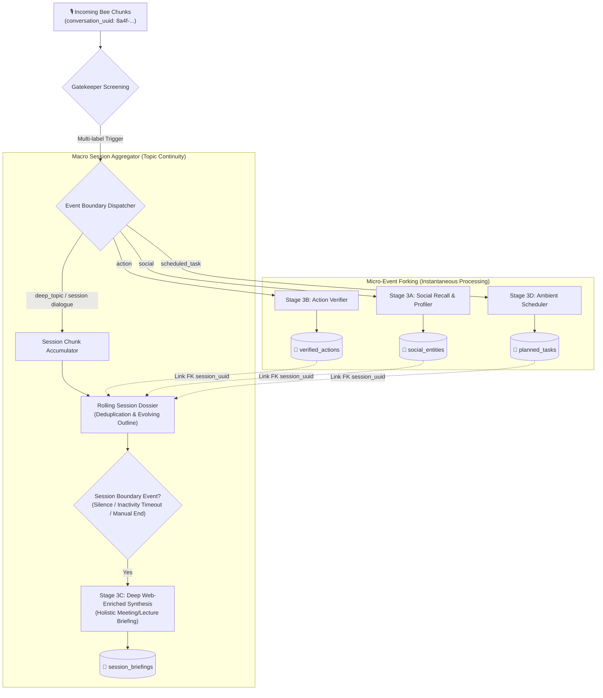

# 🔄 Session Merging & Micro-Event Splitting

> **Document Status:** Architectural Specification — **superseded for `deep_topic` by the [Deep Topic Event Engine](deep_topic_event_engine/00_overview.md)** (2026-10-13). The micro-event linking described here is still valid; macro-session aggregation, boundary detection and synthesis scheduling are now specified and implemented there (events decoupled from Bee `conversation_uuid`, segment + final briefings, topic-based resume/split).
> **Source Task:** `Next_steps.txt` — Item 3
> **Related Components:** [`orchestrator.py`](../../src/ingestion/orchestrator.py), [`graph.py`](../../src/pipeline/graph.py), [`src/core/storage/`](../../src/core/storage/), [`mcp_server.py`](../../src/serving/mcp_server.py)

---

## 1. Problem Statement: Macro Discussions vs. Micro Incidents

In ambient audio environments, conversations are fundamentally hierarchical:

1. **The Macro Context (Session Continuity):**
   - A 45-minute technical sprint planning, a 60-minute university lecture on quantum mechanics, or a 30-minute legal consultation is a continuous discourse.
   - The Bee wearable splits this audio into dozens of small 15–30 second chunks sharing a single `conversation_uuid`.
   - **Flaw of Naive Ingestion:** If each chunk is independently run through Stage 3C (`TopicResearch`), the system produces 25 fragmented, redundant, and disjointed micro-briefings instead of one coherent, evolving dossier.

2. **The Micro Incidents (Nested Multi-Domain Events):**
   - Inside a macro lecture or meeting, completely distinct real-world events occur:
     - *Minute 12:* A teammate introduces herself: *"Hi, I'm Dr. Sarah Lin, Principal Architect at Datadog."* $\rightarrow$ **Social Encounter**
     - *Minute 24:* The user performs a routine: *"I just committed and pushed the v2 schema migration to main."* $\rightarrow$ **Verified Action**
     - *Minute 38:* The user makes an ambient commitment: *"I will send Sarah the benchmark numbers by tomorrow at 2 PM."* $\rightarrow$ **Scheduled Task / Social Commitment**
   - **Flaw of Monolithic Sessioning:** If an entire conversation is classified exclusively as a "deep_topic", these critical micro-events are swallowed by the meeting notes and never trigger verification records or calendar tasks!

---

## 2. Dual-Layer Architecture: Session Dossier + Micro-Event Forking

EXAMEN resolves this through a **Hierarchical Session & Event Decoupling Engine**:



---

## 3. Macro Session Management: Aggregation & Lifecycle

### 1. Session Lifecycle State Machine

A conversation session transitions through distinct phases:

```
[NEW_CHUNK] 
    │
    ▼
[ACTIVE_SESSION] ◄─── (Additional chunks with same conversation_uuid)
    │
    ├── Inactivity Timeout (e.g., > 180 seconds of silence)
    ├── Location Shift (user moved > 500m via GPS)
    └── Explicit Closing Phrase ("That concludes today's meeting")
    │
    ▼
[FINALIZING_SYNTHESIS]
    │ (Stage 3C: Web research on aggregate topics + Explanatory synthesis)
    ▼
[CONCLUDED_DOSSIER]
```

### 2. The `SessionDossier` Schema

```python
from pydantic import BaseModel, Field
from typing import List, Optional, Dict
from datetime import datetime

class MicroEventRef(BaseModel):
    event_type: Literal["action", "social_contact", "task_scheduled"]
    record_id: str
    headline: str
    timestamp: datetime

class SessionDossier(BaseModel):
    session_id: str                      # conversation_uuid from Bee
    title: Optional[str] = None          # Evolving or finalized session title
    domain: Literal["meeting", "lecture", "technical_debate", "general"] = "meeting"
    start_time: datetime
    last_updated_at: datetime
    status: Literal["active", "finalizing", "concluded"] = "active"
    
    # Aggregated raw chunks
    transcript_chunks: List[str] = Field(default_factory=list)
    key_discussion_points: List[str] = Field(default_factory=list)
    
    # Cross-referenced micro-events
    linked_micro_events: List[MicroEventRef] = Field(default_factory=list)
    
    # Final synthesized briefing report ID
    final_briefing_id: Optional[str] = None
```

### 3. Incremental Aggregation vs. Final Synthesis

To maintain both low resource utilization and high responsiveness:
- **During the Active Session:** The system does *not* execute exhaustive web research on every 30-second chunk. Instead, it extracts key discussion topics and appends utterances into the rolling transcript.
- **On Session Boundary Trigger:** When the session concludes (or on a 15-minute checkpoint for multi-hour lectures), **Stage 3C** runs a holistic synthesis:
  1. Identifies the 2–4 dominant concepts discussed.
  2. Executes targeted web search queries via `web_search.py`.
  3. Formulates the contextual explanatory synthesis (detailed in [01_deep_topic_contextual_synthesis.md](01_deep_topic_contextual_synthesis.md)).
  4. Embeds the list of linked micro-events (actions completed, tasks scheduled, contacts met) directly into the executive dossier.

---

## 4. Micro-Event Splitting: Decoupling Nested Incidents

When a chunk arrives within an ongoing macro session, the **Semantic Gatekeeper** analyzes it for multi-label classifications:

### Example Conversational Chunk:
> *"Regarding the database migration, we decided to migrate from Postgres to DynamoDB. Oh, and by the way, I just ran the terraform apply script and created the tables in eu-west-1. Tomorrow at 10 AM I must deliver the latency benchmarks to Marco."*

### Analysis & Decomposition:
1. **Macro Dimension (`deep_topic`):** Postgres to DynamoDB migration decision $\rightarrow$ Enters `SessionDossier.transcript_chunks` and `key_discussion_points`.
2. **Micro Action (`action`):** Executed `terraform apply` and created tables in `eu-west-1` $\rightarrow$ Dispatched to `ActionVerifier` $\rightarrow$ Inserted into `verified_actions` with `session_id` back-reference.
3. **Micro Task (`scheduled_task`):** Deliver latency benchmarks to Marco tomorrow at 10 AM $\rightarrow$ Dispatched to `AmbientScheduler` $\rightarrow$ Inserted into `planned_tasks` with `session_id` back-reference.

### Cross-Referencing in SQLite Storage:

```sql
-- All micro-tables carry optional session_id foreign keys:
ALTER TABLE verified_actions ADD COLUMN session_id TEXT;
ALTER TABLE planned_tasks ADD COLUMN session_id TEXT;
ALTER TABLE social_entities ADD COLUMN session_id TEXT;

CREATE TABLE IF NOT EXISTS session_dossiers (
    session_id TEXT PRIMARY KEY,
    title TEXT,
    domain TEXT,
    start_time TEXT,
    concluded_at TEXT,
    status TEXT,
    raw_transcript TEXT,
    briefing_report_id TEXT,
    created_at TEXT
);
```

---

## 5. Multi-Modal Presentation on Echo Show

When the user queries Alexa on an Echo Show device:

### Query: *"Alexa, summarize my afternoon meeting."*

The FastMCP tool `get_session_dossier` or `get_topic_briefings` renders the unified **`SESSION_DOSSIER_VIEWER`**:

```
┌────────────────────────────────────────────────────────────────────────┐
│ 🏛️ Architecture Session: Postgres to DynamoDB Migration               │
│ 🕒 Today, 14:00 - 14:45 | 📍 Conference Room B                         │
├────────────────────────────────────────────────────────────────────────┤
│ 📖 EXPLANATORY SYNTHESIS & WEB INSIGHTS                                │
│ • DynamoDB Single-Table Design vs RDBMS: The team agreed on DynamoDB...│
│ • Research Deep-Dive: AWS documentation highlights GSI replication     │
│   delays and item size limits (400KB) as critical trade-offs...        │
├────────────────────────────────────────────────────────────────────────┤
│ ⚡ VERIFIED ACTIONS COMPLETED DURING MEETING                           │
│   ✅ 14:24 - Terraform apply executed (Tables created in eu-west-1)    │
├────────────────────────────────────────────────────────────────────────┤
│ 📅 SCHEDULED TASKS CREATED                                             │
│   📌 Tomorrow, 10:00 AM - Deliver latency benchmarks to Marco          │
├────────────────────────────────────────────────────────────────────────┤
│ 👥 CONTACTS ENCOUNTERED                                                │
│   👤 Dr. Sarah Lin (Datadog Principal Architect)                       │
└────────────────────────────────────────────────────────────────────────┘
```

---

## 6. Implementation Checklist & Migration Steps

- [x] **Orchestrator Ingestion:** Add `EventEngine` / `SessionManager` in [`orchestrator.py`](../../src/ingestion/orchestrator.py) that tracks active sessions/events and maintains inactivity timers.
- [x] **LangGraph Decoupling:** Ensure [`graph.py`](../../src/pipeline/graph.py) routes parallel micro-events concurrently while updating the session state.
- [x] **Database Schema:** Add `session_dossiers` table in [`src/core/storage/`](../../src/core/storage/) with foreign key relations on actions, tasks, and social entities.
- [x] **MCP Tooling:** Add `get_session_dossier(session_id: str)` to [`mcp_server.py`](../../src/serving/mcp_server.py) for comprehensive Echo Show meeting recap.
