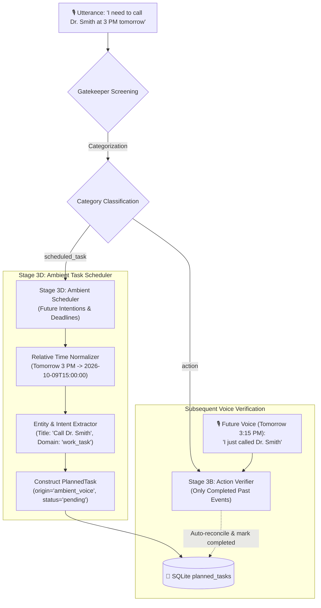
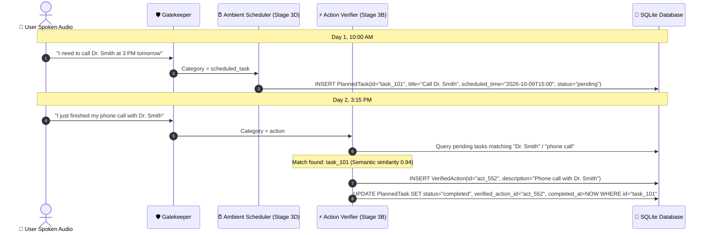

# ⏰ Ambient Scheduled Task Extraction from Voice

> **Document Status:** Architectural Specification (Implemented in Milestone 1.2)
> **Source Task:** `Next_steps.txt` — Item 4
> **Related Components:** [`gatekeeper.py`](../../src/ingestion/gatekeeper.py), [`graph.py`](../../src/pipeline/graph.py), [`schemas.py`](../../src/core/schemas.py), [`src/core/storage/`](../../src/core/storage/), [`mcp_server.py`](../../src/serving/mcp_server.py)

---

## 1. Problem Statement & Motivation

In EXAMEN's initial implementation, the **Semantic Gatekeeper** was configured with a strict safety constraint:
> *"Future intentions ('I will go to the gym', 'I should take my medicine') are NOT completed actions and MUST be classified as 'noop'."*

While this rule is critical to prevent false positives in `VerifiedAction` (which must only record confirmed, completed routines), real users continually voice forward-looking commitments:
- *"I need to call Dr. Smith at 3 PM tomorrow."*
- *"Remind me to turn off the irrigation valve in an hour."*
- *"I have to send the updated NDA to Marco before Friday at 5 PM."*

In wearable computing, requiring a user to open a smartphone app to manually type a task creates unacceptable friction. Ambient voice must seamlessly extract, structure, and register these spoken intentions into the system's planned tasks—distinguishing them clearly from manual entries and unverified routines.

---

## 2. Architectural Pipeline Integration

To support ambient task scheduling without compromising the integrity of verified actions, we introduce the **`scheduled_task`** routing category in the Gatekeeper and a dedicated **Stage 3D: Ambient Scheduler** node in LangGraph.



---

## 3. Schema Evolution (`src/core/schemas.py`)

The existing `PlannedTask` model is extended with metadata distinguishing its capture modality:

```python
from pydantic import BaseModel, Field
from typing import Optional, Literal
from datetime import datetime

class PlannedTask(BaseModel):
    id: Optional[str] = Field(default=None)
    title: str                                     # e.g., "Call Dr. Smith"
    domain: Literal["safety", "routine", "work_task", "personal"] = "routine"
    scheduled_time: Optional[str] = None          # ISO-8601 string: "2026-10-09T15:00:00"
    recurrence: str = "none"                       # "none", "daily", "weekly"
    status: Literal["pending", "completed", "cancelled"] = "pending"
    completed_at: Optional[str] = None
    verified_action_id: Optional[str] = None
    created_at: str = Field(default_factory=lambda: datetime.utcnow().isoformat())
    
    # ─── AMBIENT VOICE ENHANCEMENTS ──────────────────────────────────────────
    origin: Literal["manual", "ambient_voice", "social_commitment"] = "manual"
    raw_statement: Optional[str] = None           # Verbatim sentence spoken
    confidence: float = 1.0                       # Extraction confidence score (0.0 - 1.0)
    relative_time_anchor: Optional[str] = None    # e.g., "tomorrow at 3 PM"
    session_id: Optional[str] = None              # Linked meeting/session UUID if applicable
```

---

## 4. Gatekeeper Prompt Evolution

The Gatekeeper prompt in [`gatekeeper.py`](../../src/ingestion/gatekeeper.py) is upgraded to recognize `scheduled_task` while strictly segregating it from `action`:

```markdown
Categories to evaluate:
- "action": ONLY for COMPLETED, past-tense actions or verified routines (e.g., "I just locked the front door", "I took my morning vitamins").
- "scheduled_task": Spoken future intentions, commitments to do something later, or explicit deadlines (e.g., "I need to call Dr. Smith at 3 PM", "I must send the report by Friday", "Don't forget to buy milk on the way home").
- "social": Introductions, networking, contact mentions, or social promises.
- "deep_topic": Substantive technical, academic, medical, or complex problem-solving discussions.
- "noop": Casual chit-chat, filler words, unanchored background noise.
```

---

## 5. Stage 3D: Ambient Scheduler Extraction Logic

### 1. Relative Time Normalization Engine
Ambient speech uses colloquial, relative temporal markers. The extraction node resolves these against the utterance's `timestamp` reference:

| Spoken Phrase | Utterance Timestamp | Normalized `scheduled_time` |
|---|---|---|
| *"in twenty minutes"* | `2026-10-08T14:00:00` | `2026-10-08T14:20:00` |
| *"tomorrow morning at 9"* | `2026-10-08T14:00:00` | `2026-10-09T09:00:00` |
| *"before Friday at 5 PM"* | `2026-10-08T14:00:00` (Thu) | `2026-10-09T17:00:00` |
| *"tonight before bed"* | `2026-10-08T14:00:00` | `2026-10-08T22:00:00` |

### 2. Node Implementation Pattern (`src/pipeline/nodes/scheduler.py`)

```python
async def node_extract_scheduled_task(state: ExamenState) -> dict:
    """Stage 3D: Extracts structured planned tasks from ambient spoken intentions."""
    text = state.get("text", "")
    current_time = state.get("timestamp") or datetime.utcnow().isoformat()
    
    prompt = f"""
    You are an ambient task extraction engine.
    Current reference time: {current_time}
    
    Analyze the spoken statement: "{text}"
    Extract:
    1. title: Clean, concise imperative title (e.g., "Call Dr. Smith")
    2. domain: "safety", "routine", "work_task", or "personal"
    3. scheduled_time: ISO-8601 UTC timestamp computed relative to current reference time. If no specific time is mentioned, set to null.
    4. relative_time_anchor: The exact words indicating the time (e.g., "at 3 PM tomorrow")
    5. confidence: Float between 0.0 and 1.0 indicating clarity.
    
    Return strict JSON matching the schema.
    """
    
    response = await llm.ainvoke(prompt)
    task_data = parse_json_response(response)
    
    planned_task = PlannedTask(
        title=task_data["title"],
        domain=task_data.get("domain", "routine"),
        scheduled_time=task_data.get("scheduled_time"),
        relative_time_anchor=task_data.get("relative_time_anchor"),
        origin="ambient_voice",
        raw_statement=text,
        confidence=task_data.get("confidence", 0.95),
        status="pending"
    )
    
    return {"extracted_task": planned_task}
```

---

## 6. Closing the Loop: Auto-Reconciling Verified Actions

The true power of having both `VerifiedAction` and `PlannedTask` in EXAMEN is **Closed-Loop Task Completion**:



---

## 7. Serving via MCP & Echo Show Interface

### Alexa MCP Tool: `get_upcoming_tasks`
The MCP tool serves pending tasks with their origin badges:

```json
{
  "tasks": [
    {
      "id": "task_101",
      "title": "Call Dr. Smith",
      "scheduled_time": "2026-10-09T15:00:00",
      "origin": "ambient_voice",
      "raw_statement": "I need to call Dr. Smith at 3 PM tomorrow",
      "status": "pending"
    }
  ]
}
```

### Echo Show Task Card UI:
```
┌─────────────────────────────────────────────────────────────┐
│ 📌 Ambient Task Captured via Wearable                       │
│ ─────────────────────────────────────────────────────────── │
│ 📞 Call Dr. Smith                                           │
│ 🕒 Scheduled: Tomorrow at 3:00 PM                           │
│ 🎙️ Heard: "I need to call Dr. Smith at 3 PM tomorrow"       │
│                                                             │
│ [ ✅ Complete Now ]   [ ✏️ Edit Time ]   [ 🗑️ Discard ]     │
└─────────────────────────────────────────────────────────────┘
```
