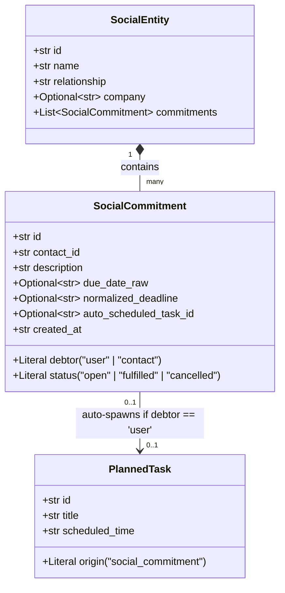

# 🤝 Structured Social Commitments & Bilateral Promises

> **Document Status:** Architectural Specification (Implemented in Milestone 1.3)
> **Source Task:** `Next_steps.txt` — Item 5
> **Related Components:** [`social.py`](../../src/pipeline/nodes/social.py), [`schemas.py`](../../src/core/schemas.py), [`src/core/storage/`](../../src/core/storage/), [`mcp_server.py`](../../src/serving/mcp_server.py)

---

## 1. Problem Statement & Baseline Deficiencies

In EXAMEN's initial baseline, social interactions extracted commitments as unstructured string arrays inside `SocialEntity` ([`schemas.py`](../../src/core/schemas.py)):

```python
# CURRENT SCHEMA (Unstructured Strings):
class SocialEntity(BaseModel):
    name: str
    relationship: str
    notes: Optional[str] = None
    last_interaction: Optional[str] = None
    commitments: List[str] = Field(default_factory=list)  # e.g., ["Send pitch deck tomorrow", "Review code"]
```

### The Inherent Flaws:
1. **Debtor Ambiguity (Who owes Whom?):** If the string says *"Send pitch deck tomorrow"*, who is responsible? Did the user promise to send it to the contact, or did the contact promise to send it to the user?
2. **Temporal Opacity:** Strings like *"by end of week"* or *"before our dinner on Thursday"* are never parsed into actionable ISO-8601 timestamps.
3. **No Closed-Loop Task Scheduling:** A user promise made in casual conversation (e.g., *"I'll email you the contract by 5 PM"*) remains trapped in contact notes instead of appearing in the user's active task list and Alexa morning briefing.

---

## 2. Bilateral Commitment Model

Social commitments are modeled as **Bilateral Agreements** with explicit debtor-creditor roles:



### Role Taxonomy

| Debtor | Meaning | System Behavior |
|---|---|---|
| **`"user"`** | The user made a promise to the contact (*"I will email you the updated budget by 4 PM"*) | 1. Saves to `SocialCommitment`<br/>2. **Automatically spawns a `PlannedTask`** (`origin='social_commitment'`) for the user's agenda.<br/>3. Alerts user when deadline approaches. |
| **`"contact"`** | The contact made a promise to the user (*"Marco promised to send the revised blueprints by Monday"*) | 1. Saves to `SocialCommitment`<br/>2. Displayed in contact's dossier under *"Awaiting Deliverables"*. Does *not* clutter the user's personal task list.<br/>3. Offers follow-up nudge: *"Marco hasn't sent the blueprints yet. Want to message him?"* |

---

## 3. Schema Definitions (`src/core/schemas.py`)

```python
from pydantic import BaseModel, Field
from typing import Optional, Literal, List
from datetime import datetime

class SocialCommitment(BaseModel):
    id: Optional[str] = Field(default=None)
    contact_name: str
    debtor: Literal["user", "contact"] = Field(
        description="Whether the user promised the contact ('user'), or the contact promised the user ('contact')"
    )
    description: str = Field(description="Concrete action or deliverable promised")
    due_date_raw: Optional[str] = Field(default=None, description="Spoken deadline phrase (e.g., 'by Monday 10 AM')")
    normalized_deadline: Optional[str] = Field(default=None, description="Normalized ISO-8601 UTC timestamp")
    status: Literal["open", "fulfilled", "cancelled"] = "open"
    auto_scheduled_task_id: Optional[str] = Field(default=None, description="FK to PlannedTask if debtor == 'user'")
    created_at: str = Field(default_factory=lambda: datetime.utcnow().isoformat())

class SocialEntity(BaseModel):
    id: Optional[str] = Field(default=None)
    name: str
    relationship: str
    notes: Optional[str] = None
    company: Optional[str] = None
    role: Optional[str] = None
    last_interaction: Optional[str] = None
    commitments: List[SocialCommitment] = Field(default_factory=list)
```

---

## 4. Extraction Engine in Stage 3A (`src/pipeline/nodes/social.py`)

Stage 3A is upgraded with a structured extraction prompt that analyzes speaker turns and grammatical subjects:

```python
COMMITMENT_EXTRACTION_PROMPT = """
You are a precise relational intelligence analyst.
Current timestamp: {current_time}
Primary User voice identifier: {user_speaker_id}

Conversation text:
"{text}"

Identify any commitments, promises, or agreements made in this dialogue.
For each commitment, extract:
1. contact_name: The name of the conversational partner.
2. debtor: 
   - "user": if the primary user is the one promising to do the action (e.g., "I'll get back to you", "I promise to send the slides").
   - "contact": if the other person is promising to do the action (e.g., "I will email you tomorrow", "Let me check and call you").
3. description: Clear imperative statement of what will be done.
4. due_date_raw: The exact spoken temporal constraint, or null if none mentioned.
5. normalized_deadline: ISO-8601 UTC timestamp calculated relative to current timestamp, or null.

Return strict JSON adhering to the schema.
"""
```

### Automatic Task Provisioning Logic:
```python
async def process_commitments(commitments: List[SocialCommitment], db: DatabaseManager):
    for commitment in commitments:
        if commitment.debtor == "user":
            # Automatically spawn a PlannedTask for the user's agenda
            task = PlannedTask(
                title=f"{commitment.description} (for {commitment.contact_name})",
                domain="work_task",
                scheduled_time=commitment.normalized_deadline,
                relative_time_anchor=commitment.due_date_raw,
                origin="social_commitment",
                raw_statement=commitment.description,
                status="pending"
            )
            task_id = await db.insert_task(task)
            commitment.auto_scheduled_task_id = task_id
            
        await db.insert_commitment(commitment)
```

---

## 5. Storage Architecture in SQLite (`src/core/database.py`)

A dedicated `social_commitments` relational table is established:

```sql
CREATE TABLE IF NOT EXISTS social_commitments (
    id TEXT PRIMARY KEY,
    contact_name TEXT NOT NULL,
    debtor TEXT CHECK(debtor IN ('user', 'contact')),
    description TEXT NOT NULL,
    due_date_raw TEXT,
    normalized_deadline TEXT,
    status TEXT DEFAULT 'open',
    auto_scheduled_task_id TEXT,
    created_at TEXT NOT NULL,
    FOREIGN KEY(contact_name) REFERENCES social_entities(name) ON DELETE CASCADE,
    FOREIGN KEY(auto_scheduled_task_id) REFERENCES planned_tasks(id) ON DELETE SET NULL
);
```

---

## 6. Multi-Modal Interaction on Echo Show

When the user queries Alexa about a contact or their upcoming social obligations:

### Query: *"Alexa, what did I promise Marco?"*

FastMCP tool `get_social_commitments(contact_name="Marco", debtor="user")`:

```
┌─────────────────────────────────────────────────────────────┐
│ 🤝 Commitments with Marco Rossi                             │
├─────────────────────────────────────────────────────────────┤
│ 📤 YOUR PROMISES TO MARCO                                   │
│  • [Due Today at 5:00 PM]                                   │
│    Send revised architectural diagram                       │
│    [ ✅ Mark Done ]   [ 🕒 Postpone ]                       │
│                                                             │
│  • [Due Friday, Oct 10]                                     │
│    Share vendor contract draft                              │
├─────────────────────────────────────────────────────────────┤
│ 📥 MARCO'S PROMISES TO YOU                                  │
│  • [Expected Yesterday]                                     │
│    Send AWS cost estimate report (Pending)                  │
│    [ 💬 Nudge Marco via Email ]                             │
└─────────────────────────────────────────────────────────────┘
```

---

## 7. Verification & Fulfill Workflow

When the user later takes action:
- *"I just sent the architectural diagram to Marco."*
- Stage 3B (`ActionVerifier`) registers the action.
- The pipeline scans open commitments with `contact_name="Marco"` and `debtor="user"`.
- It automatically marks both the `PlannedTask` and `SocialCommitment` as **`fulfilled`**!
