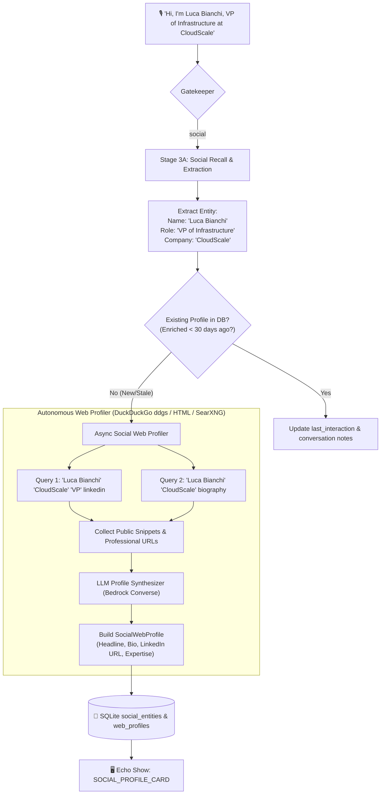

# 🌐 Autonomous Social Contact Web Enrichment

> **Document Status:** Architectural Specification (Implemented in Milestone 2.1)
> **Source Task:** `Next_steps.txt` — Item 6
> **Related Components:** [`social.py`](../../src/pipeline/nodes/social.py), [`social_profiler.py`](../../src/pipeline/nodes/social_profiler.py), [`web_search.py`](../../src/pipeline/tools/web_search.py), [`schemas.py`](../../src/core/schemas.py), [`mcp_server.py`](../../src/serving/mcp_server.py)

---

## 1. Problem Statement & Executive Value

During ambient conversations—whether at technical conferences, executive pitch sessions, academic symposiums, or casual professional networking—new contacts are constantly introduced:
- *"Hi, I'm Dr. Elena Rostova. I head the robotics vision lab at ETH Zurich."*
- *"Meet Luca Bianchi; he's the new VP of Infrastructure over at CloudScale."*

In real-world interactions:
1. **Memory Decay:** Users quickly forget the specific credentials, affiliations, or background details of newly met peers.
2. **Manual Friction:** Having to manually search LinkedIn or Google on a smartphone while engaged in conversation is socially awkward and disruptive.
3. **Ambient Intelligence Opportunity:** When a wearable captures a social introduction, EXAMEN can autonomously perform targeted public web research, construct an executive intelligence dossier, and display a formatted **`SOCIAL_PROFILE_CARD`** on the user's Echo Show or companion device.

---

## 2. Enrichment Architecture & Pipeline Flow

The enrichment engine hooks into **Stage 3A: Social Recall** as an asynchronous background worker to avoid blocking the real-time audio pipeline:



---

## 3. Disambiguation & Privacy Guardrails

Autonomous person profiling requires rigorous precision to avoid mistaking common names or intruding on personal privacy:

1. **Strict Contextual Anchoring:**
   - A search is **never** initiated on a standalone first name (e.g., *"Meet Dave"* $\rightarrow$ Skipped).
   - Profiling is triggered **only** if at least two disambiguation anchors exist:
     $$\text{Confidence Score} = \text{Full Name} + (\text{Company} \lor \text{Role} \lor \text{Location} \lor \text{Topic Domain})$$
   - If anchors are insufficient, the entity is stored locally as an unverified contact without web scraping.
2. **Public Professional Domains Only:**
   - Search queries are scoped to professional, academic, and public domain repositories:
     - LinkedIn public profiles & headlines
     - Corporate "About Us" and leadership team pages
     - Google Scholar, IEEE, arXiv author profiles
     - GitHub, personal engineering blogs, Crunchbase
   - Personal social media (Instagram, Facebook personal feeds, private forums) are explicitly excluded from search prompts.
3. **Hallucination Rejection:**
   - If web search results do not explicitly corroborate the company or role stated in the audio transcript, the LLM sets `web_profile = None` and reports `profile_status = "unverified"`.

---

## 4. Schema Definitions (`src/core/schemas.py`)

```python
from pydantic import BaseModel, Field, HttpUrl
from typing import Optional, List
from datetime import datetime

class SocialWebProfile(BaseModel):
    headline: Optional[str] = Field(default=None, description="e.g., 'VP of Infrastructure at CloudScale | ex-AWS'")
    organization: Optional[str] = Field(default=None)
    current_role: Optional[str] = Field(default=None)
    bio_summary: Optional[str] = Field(
        default=None, 
        description="2-3 sentence authoritative executive summary of professional background"
    )
    areas_of_expertise: List[str] = Field(default_factory=list)
    linkedin_url: Optional[str] = None
    website_url: Optional[str] = None
    github_url: Optional[str] = None
    confidence_score: float = Field(default=1.0, ge=0.0, le=1.0)
    enriched_at: str = Field(default_factory=lambda: datetime.utcnow().isoformat())

class SocialEntity(BaseModel):
    id: Optional[str] = Field(default=None)
    name: str
    relationship: str
    notes: Optional[str] = None
    last_interaction: Optional[str] = None
    location_encountered: Optional[str] = None
    web_profile: Optional[SocialWebProfile] = None
    commitments: List[dict] = Field(default_factory=list)
```

---

## 5. Web Search Profiling Node Implementation

```python
async def enrich_contact_profile(entity: SocialEntity, search_tool: WebSearchTool, llm: BaseChatModel) -> Optional[SocialWebProfile]:
    # 1. Guardrail: Verify minimum disambiguation anchors
    if not (entity.name and (entity.notes or " " in entity.name)):
        return None

    # 2. Formulate targeted search queries
    query = f'"{entity.name}" {entity.notes or ""} professional profile'
    search_results = await search_tool.search(query=query, max_results=4)
    
    if not search_results:
        return None
        
    # 3. LLM Synthesis
    prompt = f"""
    You are an executive research assistant.
    Target Contact: {entity.name}
    Conversation Context: {entity.notes}
    Web Search Results:
    {json.dumps(search_results, indent=2)}

    Task:
    Determine if the search results confidently match the individual described in the conversation.
    If yes, extract:
    - headline: Professional title and organization
    - organization: Current employer/institution
    - current_role: Specific job title
    - bio_summary: Concise 2-3 sentence summary of career accomplishments and background
    - areas_of_expertise: Array of top 3-5 technical or business domains
    - linkedin_url: Canonical public LinkedIn profile URL (if verified in results)
    - website_url: Company or personal homepage (if verified)

    CRITICAL RULE: If the results are ambiguous or refer to a different person with the same name, return null.
    Return strict JSON matching the schema.
    """
    
    response = await llm.ainvoke(prompt)
    data = parse_json_response(response)
    if not data:
        return None
        
    return SocialWebProfile(**data)
```

---

## 6. Multi-Modal Presentation on Echo Show

When a new contact is enriched or queried via Alexa, the FastMCP tool `get_contact_profile` renders the rich **`SOCIAL_PROFILE_CARD`**:

```
┌────────────────────────────────────────────────────────────────────────┐
│ 👤 EXECUTIVE CONTACT DOSSIER                                           │
├────────────────────────────────────────────────────────────────────────┤
│ 💼 Luca Bianchi                                                        │
│ 🏷️ VP of Infrastructure @ CloudScale | Distributed Systems Specialist   │
│ 📍 Met Today at: Coffee Bar, 4th St (15:20)                             │
├────────────────────────────────────────────────────────────────────────┤
│ 📖 PROFESSIONAL BACKGROUND                                             │
│ Luca leads the distributed systems and cloud reliability team at       │
│ CloudScale. Prior to CloudScale, he spent 6 years at AWS working on    │
│ DynamoDB storage engines. Specialized in high-throughput Raft clusters.│
│                                                                        │
│ 🎯 Expertise: [Distributed Databases] [Kubernetes] [AWS Architecture]  │
├────────────────────────────────────────────────────────────────────────┤
│ 🌐 VERIFIED LINKS                                                      │
│ 🔗 LinkedIn: linkedin.com/in/luca-bianchi-cloud                        │
│ 🔗 GitHub: github.com/lbianchi-infra                                   │
├────────────────────────────────────────────────────────────────────────┤
│ 🤝 OPEN COMMITMENTS                                                    │
│ • You promised: Send architecture whitepaper by Friday 5 PM            │
│                                                                        │
│ [ 📲 Save to Phone Contacts ]   [ 🔔 Set Follow-Up Reminder ]          │
└────────────────────────────────────────────────────────────────────────┘
```

---

## 7. FastMCP Tool Extension (`src/serving/mcp_server.py`)

We add `get_contact_profile` to the live FastMCP tool suite:

```python
@mcp.tool()
async def get_contact_profile(name: str) -> dict:
    """Retrieve an enriched executive contact dossier including public web bio,

    career credentials, verified links, and active mutual commitments.
    """
    contact = await db.get_contact_with_profile(name)
    if not contact:
        return {"found": False, "message": f"No contact record found for '{name}'."}
        
    return {
        "found": True,
        "contact": contact.dict(),
        "display_template": "SOCIAL_PROFILE_CARD"
    }
```
