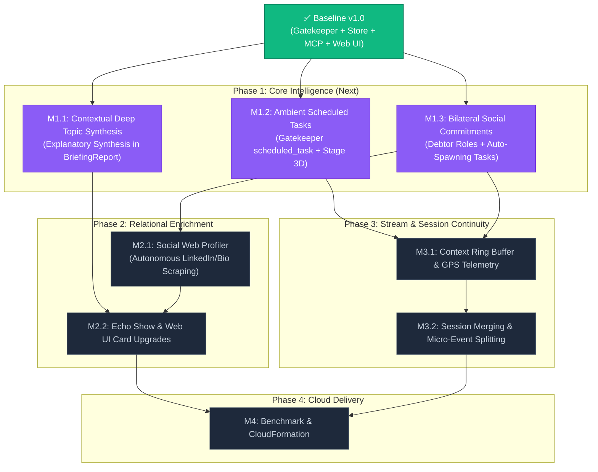

# 🗺️ EXAMEN Evolution Roadmap & Execution Plan

> **Document Status:** Active Execution Plan & Project Tracking Board  
> **Source Documents:** [00_overview.md](file:///home/deggio/Desktop/coding/hackathon/amazon_challenge/docs/next_steps/00_overview.md) to [06_social_web_enrichment.md](file:///home/deggio/Desktop/coding/hackathon/amazon_challenge/docs/next_steps/06_social_web_enrichment.md)  
> **Target Branch:** `Next_steps` / `main`  
> **Current Baseline:** v1.0.0 (89/89 Pytest suites passing, FastMCP + Web UI with Realtime SSE live)

---

## 📊 High-Level Status Dashboard

```
┌──────────────────────────────────────────────────────────────────────────────────────────────────┐
│  Phase / Milestone                                 │ Priority │ Effort │ Target Docs │ Status    │
├────────────────────────────────────────────────────┼──────────┼────────┼─────────────┼───────────┤
│  Baseline v1.0: Foundation Pipeline & Web UI       │ Critical │ High   │ docs/01-07  │ ✅ DONE   │
│  Phase 1: High-Impact Core Intelligence            │ High     │ Medium │ Docs 01,04,05│ 🔄 IN PROGRESS│
│    ├─ M1.1: Contextual Deep Topic Synthesis        │ P1       │ Medium │ Doc 01      │ ✅ DONE   │
│    ├─ M1.2: Ambient Scheduled Tasks (Voice)        │ P1       │ Medium │ Doc 04      │ ⏳ READY  │
│    └─ M1.3: Bilateral Social Commitments           │ P1       │ Medium │ Doc 05      │ ⏳ READY  │
│  Phase 2: Relational Enrichment & Multi-Modal UI   │ Medium   │ Medium │ Docs 06, UI │ ⏳ PLANNED│
│    ├─ M2.1: Autonomous Social Web Profiler         │ P2       │ Medium │ Doc 06      │ ⏳ PLANNED│
│    └─ M2.2: Echo Show & Web UI Card Upgrades       │ P2       │ Low    │ Docs 01,05,06│ ⏳ PLANNED│
│  Phase 3: Ingestion Stream & Macro Session Engine  │ Medium   │ High   │ Docs 02, 03 │ ⏳ PLANNED│
│    ├─ M3.1: Context Ring Buffer & GPS Telemetry    │ P2       │ High   │ Doc 02      │ ⏳ PLANNED│
│    └─ M3.2: Session Merging & Micro-Event Forking  │ P3       │ High   │ Doc 03      │ ⏳ PLANNED│
│  Phase 4: Cloud Hardening & Hackathon Polish       │ High     │ Low    │ Benchmarks  │ ⏳ PLANNED│
└──────────────────────────────────────────────────────────────────────────────────────────────────┘
```

---

## 🏗️ Detailed Execution Phases

### Phase 0: Baseline v1.0 — Current Foundation (COMPLETED ✅)
* [x] **Semantic Gatekeeper**: Dual-stage filtering dropping >90% ambient chatter (`src/pipeline/nodes/gatekeeper.py`).
* [x] **Dual LLM Provider**: AWS Bedrock native Converse API + AWS Bedrock Mantle runtime support (`src/core/model_factory.py`).
* [x] **LangGraph StateGraph**: Parallel fan-out routing (`social`, `action`, `deep_topic`, `noop`).
* [x] **Autonomous Web Research**: DuckDuckGo / Tavily multi-source scraping for technical topics (`src/pipeline/tools/web_search.py`).
* [x] **SQLite FTS5 Storage**: Local persistent context store with full-text search (`src/core/storage/sqlite_store.py`).
* [x] **FastMCP Serving Layer**: Streamable-HTTP server exposing Alexa+ tools on `/mcp` (`src/serving/mcp_server.py`).
* [x] **Real-Time Web UI**: Modern dark-mode dashboard with Server-Sent Events (`/api/events`), complete Routines CRUD, and Chronological Timeline view (`src/web_ui/`).
* [x] **Test Verification**: 89/89 tests passing across `tests/`.

---

### Phase 1: High-Impact Core Intelligence (READY FOR EXECUTION ⏳)
> **Goal:** Enhance reasoning depth and capture actionable intent from spoken dialogue without depending on raw BLE streaming changes.

#### 🎯 Milestone 1.1: Contextual Deep Topic Explanatory Synthesis
* **Reference Spec:** [`01_deep_topic_contextual_synthesis.md`](file:///home/deggio/Desktop/coding/hackathon/amazon_challenge/docs/next_steps/01_deep_topic_contextual_synthesis.md)
* **Status:** ✅ **COMPLETED**
* **Rationale:** Current briefings produce generic bullet points. We need a dense, pedagogical explanatory narrative that bridges dialogue concepts with authoritative web research.
* **Work Breakdown:**
  1. [x] **Schema Extension (`src/core/schemas.py`)**:
     * Added `explanatory_synthesis: str = ""` to `BriefingReport`.
     * Expanded `context_type` literal to include `"system_incident"`, `"general_meeting"`.
  2. [x] **Prompt Engineering (`src/pipeline/nodes/topic_research.py`)**:
     * Upgraded synthesizer prompt to generate 2-3 dense, educational paragraphs tailored to `context_type` (academic theory, bug failure mechanisms, architectural trade-offs).
     * Enforced citation grounding with web search URLs and guaranteed markdown depth.
  3. [x] **Storage & Serving**:
     * SQLite store persists, migrates, and indexes `explanatory_synthesis` in FTS5/queries (`src/core/storage/sqlite_store.py`).
     * Updated FastMCP `get_topic_briefing` tool, `/api/topics` endpoint, and Web UI Briefing card (`src/web_ui/`).
  4. [x] **Testing & Verification**:
     * Unit tests, integration tests, and UI asset checks passing 100% across test suites (`tests/test_storage.py`, `tests/test_pipeline_nodes.py`, `tests/test_mcp_server.py`).

#### 🎯 Milestone 1.2: Ambient Scheduled Tasks from Spoken Voice
* **Reference Spec:** [`04_ambient_scheduled_tasks.md`](file:///home/deggio/Desktop/coding/hackathon/amazon_challenge/docs/next_steps/04_ambient_scheduled_tasks.md)
* **Status:** ⏳ **READY TO IMPLEMENT**
* **Rationale:** Spoken future intentions (*"I must call Dr. Smith at 3 PM"*) were previously dropped as `noop` to protect `VerifiedAction`. They should be captured as actionable planned tasks.
* **Work Breakdown:**
  1. **Gatekeeper Upgrade (`src/pipeline/nodes/gatekeeper.py`)**:
     * Add `"scheduled_task"` category to `ChunkClassification`.
     * Update Gatekeeper prompts to distinguish completed past actions (`action`) from future commitments (`scheduled_task`).
  2. **Schema Extension (`src/core/schemas.py`)**:
     * Add `origin: Literal["manual", "ambient_voice", "social_commitment"] = "manual"`, `raw_statement`, `relative_time_anchor`, and `confidence` to `PlannedTask`.
  3. **New LangGraph Node (`src/pipeline/nodes/scheduler.py`)**:
     * Implement `node_extract_scheduled_task` with relative time normalizer (*"tomorrow morning"* -> ISO-8601 UTC timestamp).
     * Connect node to `pipeline_graph` in `src/pipeline/graph.py`.
  4. **Closed-Loop Reconciliation**:
     * Update `ActionVerifier` (`src/pipeline/nodes/action_state.py`) to auto-complete matched pending tasks when the action is later confirmed.
  5. **Testing**:
     * Unit tests for relative time parsing, closed-loop completion, and storage persistence.

#### 🎯 Milestone 1.3: Structured Bilateral Social Commitments
* **Reference Spec:** [`05_structured_social_commitments.md`](file:///home/deggio/Desktop/coding/hackathon/amazon_challenge/docs/next_steps/05_structured_social_commitments.md)
* **Status:** ⏳ **READY TO IMPLEMENT**
* **Rationale:** Current commitments are raw string arrays without debtor clarity (*who owes whom?*) or due dates.
* **Work Breakdown:**
  1. **Schema Extension (`src/core/schemas.py`)**:
     * Define `SocialCommitment` with `debtor: Literal["user", "contact"]`, `description`, `due_date_raw`, `normalized_deadline`, `status`, and `auto_scheduled_task_id`.
     * Update `SocialEntity.commitments` to use `List[SocialCommitment]`.
  2. **Extraction Engine (`src/pipeline/nodes/social.py`)**:
     * Parse grammatical subject and dialogue turn to classify debtor role (`user` vs `contact`).
     * Auto-spawn a `PlannedTask` with `origin="social_commitment"` when `debtor == "user"`.
  3. **Database Migration (`src/core/storage/sqlite_store.py`)**:
     * Create relational table `social_commitments` with foreign keys to `social_entities` and `planned_tasks`.
  4. **Serving & Reconciliation**:
     * Add FastMCP tool `get_social_commitments(contact_name, debtor)`.
     * Auto-fulfill commitment when user verifies the promised action.
  5. **Testing**:
     * Test debtor classification, task auto-spawning, and fulfillment cycle.

---

### Phase 2: Relational Enrichment & Multi-Modal Serving (PLANNED ⏳)
> **Goal:** Autonomously enrich captured contacts from public web sources and deliver premium Echo Show visual experiences.

#### 🎯 Milestone 2.1: Autonomous Social Web Profiler
* **Reference Spec:** [`06_social_web_enrichment.md`](file:///home/deggio/Desktop/coding/hackathon/amazon_challenge/docs/next_steps/06_social_web_enrichment.md)
* **Status:** ⏳ **PLANNED**
* **Work Breakdown:**
  1. **Schema**: Add `SocialWebProfile` (headline, organization, bio_summary, expertise, linkedin_url).
  2. **Profiling Node (`src/pipeline/nodes/social.py`)**:
     * Async post-processing worker executing targeted web searches.
     * **Strict 2-Anchor Disambiguation Guardrails** (Full Name + Company/Role/Location; exclude common first-name searches).
  3. **MCP Tool & UI**:
     * Expose `get_contact_profile(name)` delivering `SOCIAL_PROFILE_CARD` on Echo Show and Web UI.

#### 🎯 Milestone 2.2: Echo Show & Web UI Multi-Modal Card Upgrades
* **Status:** ⏳ **PLANNED**
* **Work Breakdown:**
  1. **Web UI**: Add tabs/drawers for viewing Social Commitments (debts owed vs awaiting) and enriched LinkedIn profiles.
  2. **Echo Show Ext-Apps**: Polish card JSON templates (`DEEP_BRIEFING_VIEWER`, `SOCIAL_PROFILE_CARD`).

---

### Phase 3: Ingestion Stream & Macro Session Engine (PLANNED ⏳)
> **Goal:** Handle long continuous meetings and streaming wearable nuances (pronouns, GPS, speaker diarization).

#### 🎯 Milestone 3.1: Context Ring Buffer & Multimodal Telemetry
* **Reference Spec:** [`02_gatekeeper_context_and_multimodal_telemetry.md`](file:///home/deggio/Desktop/coding/hackathon/amazon_challenge/docs/next_steps/02_gatekeeper_context_and_multimodal_telemetry.md)
* **Status:** ⏳ **PLANNED**
* **Work Breakdown:**
  1. **Ingestion Ring Buffer**: Implement FIFO `ContextRingBuffer` (N=3-4 chunks) in `src/ingestion/orchestrator.py` to forward conversational context on positive triggers (solving anaphora/pronoun dependencies).
  2. **GPS Telemetry Integration**: Ingest Bee `update-location` SSE events, compute `LocationTelemetry` with semantic zones (`home`, `work`, `transit`), and bind spatial metadata to actions.
  3. **Asynchronous Diarization**: 750ms debounce window + retrospective metadata patching for late-arriving `update-utterance` speaker tags.

#### 🎯 Milestone 3.2: Session Merging & Micro-Event Decoupling
* **Reference Spec:** [`03_session_merging_and_micro_event_splitting.md`](file:///home/deggio/Desktop/coding/hackathon/amazon_challenge/docs/next_steps/03_session_merging_and_micro_event_splitting.md)
* **Status:** ⏳ **PLANNED**
* **Work Breakdown:**
  1. **Session Lifecycle State Machine**: Track active `conversation_uuid` sessions, buffer transcripts, and detect session boundaries (inactivity timeout, location shift, closing phrases).
  2. **Macro Dossier Synthesis**: Compile aggregate `SessionDossier` upon boundary trigger without redundant per-chunk web queries.
  3. **Micro-Event Forking**: Simultaneously split nested actions, contacts, and tasks out of macro sessions and link them via `session_id` foreign keys.
  4. **Serving**: Add `get_session_dossier` MCP tool for unified meeting recaps.

---

### Phase 4: Cloud Hardening & Final Hackathon Delivery (PLANNED ⏳)
* [ ] **Dual-Provider Latency & Cost Benchmark**: Validate end-to-end telemetry on Bedrock Native vs. Bedrock Mantle across all upgraded nodes.
* [ ] **CloudFormation / AgentCore Deployment Script**: Automated packaging and container push.
* [ ] **Demo Scenarios & Video Asset Prep**: Polish end-to-end demo flow combining wearable voice, Echo Show visual responses, and Web UI.

---

## 📈 Dependency Graph & Recommended Execution Sequence



---

## 🛡️ Non-Regression & Quality Checklist

For every milestone implemented:
1. **100% English Codebase**: Code, comments, schemas, and documentation strictly in English.
2. **Backward-Compatible Schemas**: Defaults provided for all new fields to ensure existing `examen.db` records remain valid.
3. **Comprehensive Pytest Coverage**: Add unit, integration, and mock tests to `tests/` before marking any milestone done.
4. **FastMCP Schema Cleanliness**: Keep tool signatures client-friendly with primitives and validated Pydantic types.
5. **Realtime Web UI Synchronization**: Broadcast SSE events (`/api/events`) for any new or modified entities.
