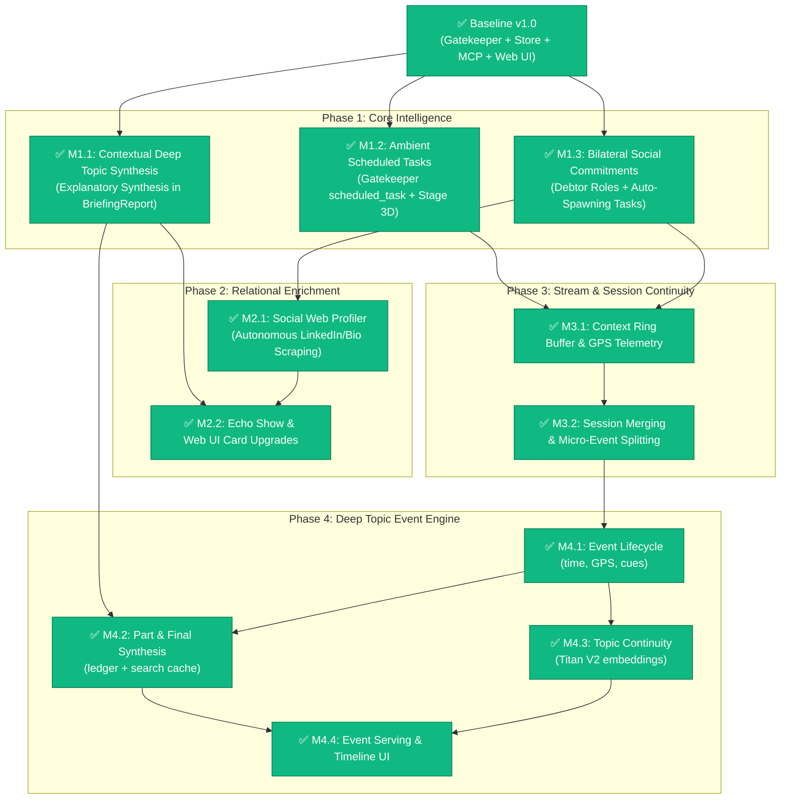

# 🗺️ EXAMEN Evolution Roadmap & Execution Plan

> **Document Status:** Active Execution Plan & Project Tracking Board  
> **Source Documents:** [00_overview.md](00_overview.md) to [06_social_web_enrichment.md](06_social_web_enrichment.md)  
> **Target Branch:** `Next_steps` / `main`  
> **Current Baseline:** v1.4.0 (272/272 Pytest suites passing 100% green, Deep Topic Event Engine + Next.js event timeline live)

---

## 📊 High-Level Status Dashboard

```
┌──────────────────────────────────────────────────────────────────────────────────────────────────┐
│  Phase / Milestone                                 │ Priority │ Effort │ Target Docs │ Status    │
├────────────────────────────────────────────────────┼──────────┼────────┼─────────────┼───────────┤
│  Baseline v1.0: Foundation Pipeline & Web UI       │ Critical │ High   │ docs/01-07  │ ✅ DONE   │
│  Phase 1: High-Impact Core Intelligence            │ High     │ Medium │ Docs 01,04,05│ ✅ COMPLETED│
│    ├─ M1.1: Contextual Deep Topic Synthesis        │ P1       │ Medium │ Doc 01      │ ✅ DONE   │
│    ├─ M1.2: Ambient Scheduled Tasks (Voice)        │ P1       │ Medium │ Doc 04      │ ✅ DONE   │
│    └─ M1.3: Bilateral Social Commitments           │ P1       │ Medium │ Doc 05      │ ✅ DONE   │
│  Phase 2: Relational Enrichment & Multi-Modal UI   │ Medium   │ Medium │ Docs 06, UI │ ✅ COMPLETED│
│    ├─ M2.1: Autonomous Social Web Profiler         │ P2       │ Medium │ Doc 06      │ ✅ DONE   │
│    └─ M2.2: Echo Show & Web UI Card Upgrades       │ P2       │ Low    │ Docs 01,05,06│ ✅ DONE   │
│  Phase 3: Ingestion Stream & Macro Session Engine  │ Medium   │ High   │ Docs 02, 03 │ ✅ COMPLETED│
│    ├─ M3.1: Context Ring Buffer & GPS Telemetry    │ P2       │ High   │ Doc 02      │ ✅ DONE   │
│    └─ M3.2: Session Merging & Micro-Event Forking  │ P3       │ High   │ Doc 03      │ ✅ DONE   │
│  Phase 4: Deep Topic Event Engine                  │ High     │ High   │ DTEE 00-07  │ ✅ COMPLETED│
│    ├─ M4.1: Event lifecycle (time, GPS, cues)      │ P1       │ High   │ DTEE 01, 05 │ ✅ DONE   │
│    ├─ M4.2: Part & consolidated synthesis          │ P1       │ Medium │ DTEE 03, 04 │ ✅ DONE   │
│    ├─ M4.3: Topic continuity (Titan V2 embeddings) │ P1       │ High   │ DTEE 02     │ ✅ DONE   │
│    └─ M4.4: Event serving & dashboard timeline     │ P2       │ Medium │ DTEE 06     │ ✅ DONE   │
│  Phase 5: Historical Transcript Backfill           │ High     │ High   │ HTB 00-05   │ ✅ IMPLEMENTED│
│    ├─ M5.1: Coverage ledger & gap detection        │ P1       │ Medium │ HTB 02, 04  │ ✅ DONE   │
│    ├─ M5.2: History source & free preview          │ P1       │ Medium │ HTB 01, 02  │ ✅ DONE   │
│    ├─ M5.3: Replay executor & temporal guards      │ P1       │ High   │ HTB 03      │ ✅ DONE   │
│    ├─ M5.4: Startup / reconnect auto catch-up      │ P2       │ Medium │ HTB 03      │ ✅ DONE   │
│    └─ M5.5: History Sync UI                        │ P2       │ Medium │ HTB 04      │ ✅ DONE   │
└──────────────────────────────────────────────────────────────────────────────────────────────────┘

> **DTEE** = [docs/next_steps/deep_topic_event_engine/](deep_topic_event_engine/00_overview.md)
> **HTB** = [docs/next_steps/historical_backfill/](historical_backfill/00_overview.md)
```

---

## 🏗️ Detailed Execution Phases

### Phase 0: Baseline v1.0 — Current Foundation (COMPLETED ✅)
* [x] **Semantic Gatekeeper**: Dual-stage filtering dropping >90% ambient chatter (`src/pipeline/nodes/gatekeeper.py`).
* [x] **Dual LLM Provider**: AWS Bedrock native Converse API + AWS Bedrock Mantle runtime support (`src/core/model_factory.py`).
* [x] **LangGraph StateGraph**: Parallel fan-out routing (`social`, `action`, `deep_topic`, `noop`).
* [x] **Autonomous Web Research**: DuckDuckGo / Tavily multi-source scraping for technical topics (`src/pipeline/tools/web_search.py`).
* [x] **SQLite FTS5 Storage**: Local persistent context store with full-text search (`src/core/storage/sqlite_store.py`).
* [x] **FastMCP Serving Layer**: Streamable-HTTP server exposing Alexa+ tools on `/mcp` (`src/serving/mcp_server.py`).
* [x] **Real-Time Web UI**: Modern dark-mode dashboard with Server-Sent Events (`/api/events`), complete Routines CRUD, and Chronological Timeline view (`src/web_ui/`).
* [x] **Test Verification**: 89/89 tests passing across `tests/`.

---

### Phase 1: High-Impact Core Intelligence (COMPLETED ✅)
> **Goal:** Enhance reasoning depth and capture actionable intent from spoken dialogue without depending on raw BLE streaming changes.

#### 🎯 Milestone 1.1: Contextual Deep Topic Explanatory Synthesis
* **Reference Spec:** [`01_deep_topic_contextual_synthesis.md`](01_deep_topic_contextual_synthesis.md)
* **Status:** ✅ **COMPLETED**
* **Rationale:** Current briefings produce generic bullet points. We need a dense, pedagogical explanatory narrative that bridges dialogue concepts with authoritative web research.
* **Work Breakdown:**
  1. [x] **Schema Extension (`src/core/schemas.py`)**:
     * Added `explanatory_synthesis: str = ""` to `BriefingReport`.
     * Expanded `context_type` literal to include `"system_incident"`, `"general_meeting"`.
  2. [x] **Prompt Engineering (`src/pipeline/nodes/topic_research.py`)**:
     * Upgraded synthesizer prompt to generate 2-3 dense, educational paragraphs tailored to `context_type` (academic theory, bug failure mechanisms, architectural trade-offs).
     * Enforced citation grounding with web search URLs and guaranteed markdown depth.
  3. [x] **Storage & Serving**:
     * SQLite store persists, migrates, and indexes `explanatory_synthesis` in FTS5/queries (`src/core/storage/sqlite_store.py`).
     * Updated FastMCP `get_topic_briefing` tool, `/api/topics` endpoint, and Web UI Briefing card (`src/web_ui/`).
  4. [x] **Testing & Verification**:
     * Unit tests, integration tests, and UI asset checks passing 100% across test suites (`tests/test_storage.py`, `tests/test_pipeline_nodes.py`, `tests/test_mcp_server.py`).

#### 🎯 Milestone 1.2: Ambient Scheduled Tasks from Spoken Voice
* **Reference Spec:** [`04_ambient_scheduled_tasks.md`](04_ambient_scheduled_tasks.md)
* **Status:** ✅ **COMPLETED**
* **Rationale:** Spoken future intentions (*"I must call Dr. Smith at 3 PM"*, *"Remind me to turn off irrigation in an hour"*) were previously dropped as `noop` to protect `VerifiedAction`. They are now captured as actionable planned tasks.
* **Work Breakdown:**
  1. [x] **Gatekeeper Upgrade (`src/ingestion/gatekeeper.py`)**:
     * Added `"scheduled_task"` category to `ChunkClassification`.
     * Updated Gatekeeper prompt and regex heuristic to strictly differentiate doubts/queries (`"did I"`, `"wonder if"`) -> `noop` from forward commitments (`"need to"`, `"remind me to"`, `"must"`) -> `scheduled_task`.
  2. [x] **Schema Extension (`src/core/schemas.py`)**:
     * Added `origin: Literal["manual", "ambient_voice", "social_commitment"] = "manual"`, `raw_statement`, `confidence`, `relative_time_anchor`, and `session_id` to `PlannedTask`.
     * Added `ScheduledTaskExtraction` Pydantic model for structured LLM extraction.
     * Extended `ExamenState` with `scheduled_task: Optional[PlannedTask]`.
  3. [x] **New LangGraph Node (`src/pipeline/nodes/scheduler.py`)**:
     * Implemented deterministic `parse_relative_time_expression` (*"in 30 minutes"*, *"in an hour"*, *"tomorrow at 3 pm"*, *"tonight at 9 pm"*) computing ISO-8601 timestamps.
     * Built `node_extract_scheduled_task` LangGraph node with Bedrock structured output and heuristic fallback.
     * Connected parallel routing branch in `src/pipeline/graph.py` and state persistence in `src/pipeline/nodes/persist.py`.
  4. [x] **Storage & FastMCP Serving Layer (`src/core/storage/sqlite_store.py`, `src/serving/tools/action_tools.py`, `src/serving/mcp_server.py`)**:
     * Non-blocking schema migration for `origin`, `raw_statement`, `confidence`, `relative_time_anchor`, `session_id`.
     * Implemented `get_upcoming_tasks` tool for Alexa+ / FastMCP.
     * Exposed full origin metadata in `/api/routines` REST endpoints.
  5. [x] **Web UI Dashboard Rendering (`src/web_ui/`)**:
     * Added `🎙️ Ambient Voice` badge, verbatim spoken quotes, and time anchor badges in the Routines list.
  6. [x] **Testing & Verification**:
     * 100/100 tests passing with 0 errors across all test suites (`tests/test_gatekeeper.py`, `tests/test_pipeline_nodes.py`, `tests/test_langgraph_pipeline.py`, `tests/test_mcp_server.py`, `tests/test_storage.py`).

#### 🎯 Milestone 1.3: Structured Bilateral Social Commitments
* **Reference Spec:** [`05_structured_social_commitments.md`](05_structured_social_commitments.md)
* **Status:** ✅ **COMPLETED**
* **Rationale:** Current commitments are raw string arrays without debtor clarity (*who owes whom?*) or due dates. Upgraded to structured bilateral promises with automatic agenda provisioning, closed-loop reconciliation, FastMCP tools, and interactive Web UI management.
* **Work Breakdown:**
  1. [x] **Schema Extension (`src/core/schemas.py`)**:
     * Defined `SocialCommitment` model with `debtor: Literal["user", "contact"]`, `description`, `due_date_raw`, `normalized_deadline`, `status`, and `auto_scheduled_task_id`.
     * Added string backward compatibility methods (`__str__`, `lower`, `__contains__`) and `SocialEntity.get_commitments_as_objects()`.
  2. [x] **Extraction Engine (`src/pipeline/nodes/social.py`)**:
     * Upgraded Stage 3A prompt and heuristic extractor to capture bilateral commitments with relative time parsing via `parse_relative_time_expression`.
     * Automatically populated `contact_name` and normalized timestamps.
  3. [x] **Database & Agenda Provisioning (`src/core/storage/sqlite_store.py`)**:
     * Created `social_commitments` relational table with indexed columns (`contact_name`, `debtor`, `status`).
     * Auto-provisions a `PlannedTask` with `origin="social_commitment"` when `debtor == "user"`.
     * Implemented closed-loop reconciliation in `match_and_resolve_task`: verified actions automatically mark linked commitments as `fulfilled`.
  4. [x] **Serving Layer & FastMCP Tool (`src/serving/tools/social_tools.py`, `src/serving/mcp_server.py`)**:
     * Added FastMCP `get_social_commitments` tool with debtor and status filtering for Alexa+.
     * Added REST endpoints: `GET /api/commitments`, `POST /api/commitments`, `POST /api/commitments/{id}/fulfill`, `POST /api/commitments/{id}/cancel`.
     * Real-time SSE broadcast of `commitment_created` and `commitment_updated`.
  5. [x] **Web UI Dashboard (`src/web_ui/`)**:
     * Rendered debtor badges (`📤 You Promised` vs `📥 Contact Promised`), deadline pill (`⏱️`), and instant fulfillment button (`✓ Done`).
  6. [x] **Testing & Verification**:
     * Comprehensive unit and integration test coverage (`tests/test_storage.py`, `tests/test_pipeline_nodes.py`, `tests/test_mcp_server.py`).

---

### Phase 2: Relational Enrichment & Multi-Modal Serving (COMPLETED ✅)
> **Goal:** Autonomously enrich captured contacts from public web sources and deliver premium Echo Show visual experiences.

#### 🎯 Milestone 2.1: Autonomous Social Web Profiler
* **Reference Spec:** [`06_social_web_enrichment.md`](06_social_web_enrichment.md)
* **Status:** ✅ **COMPLETED**
* **Rationale:** During professional meetings and conferences, newly encountered peers often need authoritative background context without the user awkwardly typing into a phone. EXAMEN autonomously builds an executive dossier using public web intelligence while enforcing strict privacy and disambiguation guardrails.
* **Work Breakdown:**
  1. [x] **Schema Extension (`src/core/schemas.py`, `src/core/__init__.py`)**:
     * Added `SocialWebProfile` model with `headline`, `organization`, `current_role`, `bio_summary`, `areas_of_expertise`, `linkedin_url`, `website_url`, `github_url`, `confidence_score`, and `enriched_at`.
     * Added `web_profile: Optional[SocialWebProfile]` to `SocialEntity`.
  2. [x] **Storage & Non-Blocking Migration (`src/core/storage/sqlite_store.py`, `src/core/storage/base.py`)**:
     * Added automatic migration for `web_profile_json TEXT` column in `social_contacts`.
     * Implemented `get_social_contact(id_or_name)` and `update_contact_web_profile(id_or_name, profile)`.
     * Guaranteed preservation of existing web profiles across entity deduplication and updates.
  3. [x] **Autonomous Profiler Node (`src/pipeline/nodes/social_profiler.py`, `src/pipeline/nodes/social.py`)**:
     * Implemented `verify_disambiguation_anchors` with strict 2-anchor guardrails (rejects standalone ambiguous first names like "Dave", requires Full Name + Company/Role/Topics or First Name + Strong Organization).
     * Query builder `build_profiling_queries` scoping searches to public professional sources (LinkedIn, GitHub, corporate leadership, Wikipedia) and excluding personal networks (Instagram, TikTok).
     * Dual-mode synthesizer: Bedrock structured output when online and deterministic heuristic synthesizer for offline / mock testing.
     * Connected background enrichment hook in `node_extract_social`.
  4. [x] **Serving Layer & FastMCP Tool (`src/serving/tools/social_tools.py`, `src/serving/mcp_server.py`)**:
     * Implemented FastMCP `get_contact_profile` tool rendering `display_template: "SOCIAL_PROFILE_CARD"` formatted for Alexa+ / Echo Show with spoken bio and mutual commitments.
     * Exposed REST endpoints: `GET /api/contacts/{id}/profile` and `POST /api/contacts/{id}/enrich`.
     * Broadcast real-time SSE event `contact_enriched`.
  5. [x] **Web UI Dashboard Presentation (`src/web_ui/`)**:
     * Rendered executive web profile dossier with headline, bio summary, expertise pills, and verified links (LinkedIn, GitHub, Website).
     * Added interactive `[⚡ Enrich Profile]` / `[🔄 Refresh Intelligence]` action with dynamic loading feedback.
  6. [x] **Testing & Verification**:
     * Comprehensive unit and integration test coverage across `tests/test_storage.py`, `tests/test_pipeline_nodes.py`, `tests/test_mcp_server.py`.

#### 🎯 Milestone 2.2: Echo Show & Web UI Multi-Modal Card Upgrades
* **Reference Spec:** [`01_deep_topic_contextual_synthesis.md`](01_deep_topic_contextual_synthesis.md), [`05_structured_social_commitments.md`](05_structured_social_commitments.md), [`06_social_web_enrichment.md`](06_social_web_enrichment.md), [`docs/03_alexa_mcp_serving.md`](../03_alexa_mcp_serving.md)
* **Status:** ✅ **COMPLETED**
* **Rationale:** Delivers executive-grade visual experiences across both desktop browsers and Alexa+ Echo Show smart screens (Ext-Apps touch canvas). Standardized multi-modal JSON templates across FastMCP tools and introduced a dedicated simulated Echo Show hardware previewer, bilateral commitments management board, and full executive dossier modals.
* **Work Breakdown:**
  1. [x] **FastMCP Serving Tools Multi-Modal Standardization (`src/serving/tools/`)**:
     * Standardized dual template fields (`display_template` and legacy `ui_card_type`) plus structured `card_payload` across all FastMCP tools:
       - `DEEP_BRIEFING_VIEWER`: topic title, executive bullets, contextual synthesis card, and online source links.
       - `SOCIAL_PROFILE_CARD`: executive bio, match confidence, expertise chips, verified URLs, and active promises.
       - `SOCIAL_COMMITMENTS_CARD`: split user debts (`📤 You Promised`) vs claims (`📥 Contact Promised`) with touch actions.
       - `ACTION_VERIFIED_BADGE` / `ACTION_UNVERIFIED_BADGE`: high-contrast verified status badge with audio statement quote.
       - `DAILY_ACTIONS_RECAP`: comprehensive daily summary of planned routines vs acoustic triggers.
       - `UPCOMING_TASKS_VIEWER`: scheduled tasks timeline with touch status toggles.
  2. [x] **Storage Layer Enhancements (`src/core/storage/base.py`, `src/core/storage/sqlite_store.py`)**:
     * Implemented `delete_social_commitment(id)` with cascading clean-up of auto-provisioned agenda planned tasks.
  3. [x] **Serving Layer Endpoints (`src/serving/mcp_server.py`)**:
     * Added `GET /api/commitments/{id}` and `DELETE /api/commitments/{id}` with real-time SSE broadcasts.
     * Added `GET /api/cards/preview` returning formatted card payloads and spoken summaries for Echo Show Ext-Apps with template switching.
  4. [x] **Web UI Multi-Modal & Social Hub Upgrades (`src/web_ui/`)**:
     * **Header**: Added `[📺 Echo Show Cards]` hardware previewer trigger with live device simulation.
     * **Social Rolodex Sub-Navigation**: Seamless subtabs for `👥 All Contacts`, `🤝 Bilateral Commitments`, and `⚡ Executive Dossiers`.
     * **Bilateral Commitments Board**: Filter pills (`All`, `📤 Debts I Owe`, `📥 Owed to Me`, `✓ Fulfilled`), 1-click status toggles, deletion, and linked routine tracking.
     * **Interactive `+ New Commitment` Drawer**: Slide-down drawer with contact auto-complete datalist, debtor role picker, and date anchors.
     * **Executive Dossier Modal (`#modal-executive-dossier`)**: Dedicated modal with avatar monogram, verified match score, biography narrative, expertise pills, and authenticated external links (LinkedIn, GitHub, Website).
     * **Simulated Echo Show Device Modal (`#modal-echo-show`)**: 16:10 hardware bezel with camera notch, real-time clock, Alexa+ Ext-App system bar, 6-template interactive switcher, dynamic touch canvas, and Alexa spoken voice response wave.
     * **Deep Linking**: Direct URL query parameter activation (`?card=...`, `?mode=ext-app`, `?contact=...`).
  5. [x] **Testing & Verification**:
     * 100% green verification: 40/40 tests passing on storage and MCP server, 117/117 passing across the entire repository.

---

### Phase 3: Ingestion Stream & Macro Session Engine (COMPLETED ✅)
> **Goal:** Handle long continuous meetings and streaming wearable nuances (pronouns, GPS, speaker diarization).

#### 🎯 Milestone 3.1: Context Ring Buffer & Multimodal Telemetry
* **Reference Spec:** [`02_gatekeeper_context_and_multimodal_telemetry.md`](02_gatekeeper_context_and_multimodal_telemetry.md)
* **Status:** ✅ **COMPLETED**
* **Rationale:** Spoken ambient dialogue from wearable microphones often splits critical context across conversational turns (e.g. "Did you lock the door?" followed by "Yes, I just did"). Implemented a low-overhead FIFO Context Ring Buffer ($N=4$ chunks) with hybrid anaphora gatekeeper evaluation, multimodal GPS telemetry ingestion with semantic zone inference, and retrospective speaker diarization patching.
* **Work Breakdown:**
  1. [x] **Schema & Telemetry Contracts (`src/core/schemas.py`, `src/core/__init__.py`)**:
     * Added `LocationTelemetry` model with coordinates, place name, accuracy, and auto-inference of `semantic_zone` (`home`, `work_office`, `transit`, `public_venue`, `unknown`).
     * Added `UtteranceChunk` model with `chunk_id`, `speaker_id`, `speaker_role` (`user`, `contact`, `unknown`), and `location`.
     * Extended `VerifiedAction.location`, `PlannedTask.location`, and `SocialEntity.location_encountered`.
     * Added `historical_context`, `location`, `speaker`, `speaker_role`, and `utterance_id` to `ExamenState`.
  2. [x] **Context Ring Buffer Engine (`src/ingestion/ring_buffer.py`, `src/ingestion/__init__.py`)**:
     * Implemented `ContextRingBuffer` with FIFO capacity $N=4$ rolling deque per active conversation session.
     * Provided `get_historical_context`, `get_concatenated_context_text` (with speaker/role labels), and `get_rolling_summary_hint` for lightweight Gatekeeper prompt injection.
     * Added `patch_speaker` for retroactive diarization reconciliation and `get_last_chunk`.
  3. [x] **Semantic Gatekeeper Anaphora Optimization (`src/ingestion/gatekeeper.py`)**:
     * Integrated `prior_context` into `classify_chunk`, `aclassify_chunk`, and prompt construction.
     * Enhanced heuristic classification to detect split anaphora patterns ("Sure, consider it done", "I just did", "Locked it") without inflating input token costs on 90% dropped ambient audio.
  4. [x] **Storage & Database Non-Blocking Migrations (`src/core/storage/sqlite_store.py`, `src/core/storage/base.py`)**:
     * Added automatic column migrations for `location_json` on `verified_actions` and `planned_tasks`, and `location_encountered` on `social_contacts`.
     * Created `utterance_diarization` relational table with indexed speaker mappings.
     * Implemented `patch_utterance_speaker(chunk_id, speaker_id, speaker_role)` for retrospective diarization updates on tasks, actions, and cache.
  5. [x] **Pipeline Grounding & Role Calibration (`src/pipeline/nodes/action_state.py`, `src/pipeline/nodes/social.py`, `src/pipeline/app.py`)**:
     * `node_extract_action`: Resolves split anaphora dialogue and grounds physical action location from current telemetry.
     * `node_extract_social`: Resolves entity introductions across turns, captures `location_encountered`, and aligns commitment debtor to `"contact"` when spoken by an interlocutor (`speaker_role == "contact"`).
  6. [x] **Streaming Orchestrator SSE Integration (`src/ingestion/orchestrator.py`, `src/ingestion/stream_convo.py`)**:
     * Ingests Bee `update-location` SSE events, updates `latest_telemetry`, and binds spatial metadata to subsequent chunks.
     * Ingests `update-utterance` events, patching late-arriving speaker tags in ring buffer and SQLite store.
     * ⚠️ **2026-10-19 device test:** `update-utterance` does not exist and the Apple Watch emits no `update-location`. Real speaker identity comes from `tagged-utterance` and locations from `bee locations current`: see [10_bee_cli_reference.md](../10_bee_cli_reference.md) §10 (C2, C5, C6).
     * Forwards rolling dialogue history to downstream LangGraph nodes upon Gatekeeper qualification.
  7. [x] **Testing & Verification**:
     * Created comprehensive test suite `tests/test_ring_buffer.py` (17/17 tests passing).
     * 100% green verification: 134/134 tests passing across the repository.

#### 🎯 Milestone 3.2: Session Merging & Micro-Event Decoupling
* **Reference Spec:** [`03_session_merging_and_micro_event_splitting.md`](03_session_merging_and_micro_event_splitting.md)
* **Status:** ✅ **COMPLETED**
* **Rationale:** Decouples macro conversation continuity (30-60 min meetings/lectures) from instantaneous micro-incidents (verifying actions, meeting contacts, scheduling tasks). Prevents redundant external search API hammer on every 15-30s audio chunk while ensuring micro-records are immediately extracted, foreign-key linked, and integrated into a holistic session dossier upon boundary detection.
* **Work Breakdown:**
  1. [x] **Schema & Relational Contracts (`src/core/schemas.py`, `src/core/__init__.py`)**:
     * Added `MicroEventRef` model (`event_type`, `record_id`, `headline`, `timestamp`).
     * Added `SessionDossier` model (`session_id`, `title`, `domain`, `start_time`, `last_updated_at`, `concluded_at`, `status`, `location`, `transcript_chunks`, `key_discussion_points`, `linked_micro_events`, `final_briefing_id`, `briefing_report`).
     * Added `session_id: Optional[str]` to `VerifiedAction`, `SocialEntity`, `PlannedTask`, and `ExamenState`.
  2. [x] **Storage & Database Persistence (`src/core/storage/base.py`, `src/core/storage/sqlite_store.py`)**:
     * Created `session_dossiers` relational table with indexed columns (`status`, `start_time DESC`).
     * Added non-blocking migrations for `session_id TEXT` on `verified_actions` and `social_contacts`.
     * Implemented `save_session_dossier`, `get_session_dossier`, `list_session_dossiers`, `append_chunk_to_session`, `link_micro_event_to_session`, and `conclude_session_dossier`.
  3. [x] **Session Manager Engine (`src/ingestion/session_manager.py`, `src/ingestion/__init__.py`)**:
     * Built `SessionManager` tracking active wearable `conversation_uuid` streams.
     * Boundary detection: regex closing phrase detector (English & Italian), inactivity timeout detector ($\Delta t \ge 180$s), and Haversine GPS displacement detector ($d \ge 500$m).
     * Integrated into `BeeStreamOrchestrator` in `src/ingestion/orchestrator.py`.
  4. [x] **Micro-Event Decoupling in LangGraph (`src/pipeline/nodes/persist.py`)**:
     * In `node_persist`: automatically tags and links micro-event references (`action`, `social_contact`, `task_scheduled`) to `SessionDossier.linked_micro_events` using `session_id`.
     * Automatically concludes session and links briefing ID when a holistic `briefing_report` is persisted.
  5. [x] **FastMCP Serving & REST APIs (`src/serving/tools/session_tools.py`, `src/serving/mcp_server.py`)**:
     * Added FastMCP tools: `get_session_dossier(session_id)` and `list_session_dossiers(status, limit)`.
     * Implemented `SESSION_DOSSIER_VIEWER` template payload with spoken summary and key metrics.
     * Added REST endpoints: `GET /api/sessions`, `GET /api/sessions/{id}`, `POST /api/sessions/{id}/conclude`.
     * Added Echo Show hardware preview modal tab for `SESSION_DOSSIER_VIEWER` in `src/web_ui/`.
  6. [x] **Testing & Verification**:
     * Created comprehensive test suite `tests/test_session_manager.py` (18/18 tests passing).
     * Extended `tests/test_mcp_server.py` with session endpoints tests (32/32 tests passing).
     * 100% green verification: 154/154 tests passing across the repository.

---

### Phase 4: Deep Topic Event Engine (COMPLETED ✅)
> **Goal:** Turn a stream of short utterances into coherent lecture/meeting dossiers: one event per lecture (surviving breaks), separate events for back-to-back lectures, progressive part briefings and a consolidated final briefing — at a fraction of the per-utterance research cost.
> **Specification:** [deep_topic_event_engine/](deep_topic_event_engine/00_overview.md) (supersedes the `deep_topic` part of [03_session_merging_and_micro_event_splitting.md](03_session_merging_and_micro_event_splitting.md)).

#### 🎯 Milestone 4.1: Event Lifecycle — time, GPS & cues (Phase A)
* **Status:** ✅ **COMPLETED**
* [x] `EventEngine` ([event_engine.py](../../src/ingestion/event_engine.py)): pure, clock-injectable state machine (ACTIVE / PAUSED / CONCLUDED, rules R0–R8), events decoupled from Bee `conversation_uuid`, accuracy-aware GPS shift, IT/EN pause & closing cues, tick loop + restart rehydration.
* [x] Utterance receive-time captured in `stream_convo.py` and propagated end to end; `session_chunks` per-utterance log; `deep_topic` routed to research only outside events (`event_managed`); `node_persist` no longer concludes sessions; pipeline calls moved off the event loop.
* [x] Defaults `T_soft = 5 min`, `T_hard = 30 min` (+ `EVENT_PROFILE=demo`).

#### 🎯 Milestone 4.2: Part & Consolidated Synthesis (Phase B)
* **Status:** ✅ **COMPLETED**
* [x] Stage 3C refactored into `extract_topics` / `research` / `synthesize_briefing`; `PipelineEventSynthesizer` with event outline, long-transcript condensation, gap-only final research, "During this event" micro-events section, single-part promotion.
* [x] Per-event query ledger + global `web_search_cache` (24 h TTL); real Bedrock run: the final briefing of a two-part lecture needed **0 new searches**.

#### 🎯 Milestone 4.3: Topic Continuity (Phase C)
* **Status:** ✅ **COMPLETED**
* [x] Titan Text Embeddings V2 (512 dims) with heuristic and LLM-judge fallbacks ([topic_continuity.py](../../src/ingestion/topic_continuity.py)); micro-windows keep terse `noop` lecture sentences on-topic; pending window decides resume (R4) vs. new event (R7); drift without a pause (R9) with chunk-level split refinement; Bee conversation titles and gatekeeper event hint.
* [x] Calibrated on 5 replay scenarios ([event_scenarios.json](../../resources/event_scenarios.json)): **5/5 with both backends**; thresholds `0.42 / 0.37` (embedding), `0.20 / 0.10` (heuristic).

#### 🎯 Milestone 4.4: Event Serving & Dashboard Timeline (Phase D)
* **Status:** ✅ **COMPLETED**
* [x] REST: event summaries/detail/chunks, pause ("synthesize now"), resume, split, merge, simulator virtual clock, scenarios; SSE `event_*` / `segment_*`; MCP `get_live_event_outline`, partial-briefing fallback in `get_session_dossier`, Echo Show event parts.
* [x] Next.js: *Topic Dossiers → Events* timeline with decision audit trail and manual operations, simulator event mode + scenario player, live event banner in Overview.

#### ⏭️ Open items
* [x] Capture real `bee stream --json` payloads (event type field, utterance time): done 2026-10-19 ([10](../10_bee_cli_reference.md) §7). `new-conversation` / `update-conversation` still to be captured.
* [ ] Record real lectures as replay scenarios and re-run `scripts/replay_event_scenarios.py --calibrate`.

### Phase 5: Historical Transcript Backfill (IMPLEMENTED ✅, device verification pending)
> **Goal:** Never lose ambient context because EXAMEN was offline. Detect coverage gaps, fill them automatically after a restart/reconnect (bounded look-back), and let the user analyse any past period from the UI, skipping what was already analysed live.
> **Specification:** [historical_backfill/](historical_backfill/00_overview.md).

* [x] **M5.1 Coverage ledger:** live coverage intervals, per-utterance ingest ledger (noop included), Bee uuid↔id map, idempotent `source_key` ids.
* [x] **M5.2 History source & preview:** `BeeHistorySource` over `bee conversations list/get --json`, final-transcription selection, live/backfill de-duplication, free `POST /api/backfill/preview`.
* [x] **M5.3 Replay executor:** isolated `EventEngine` on a virtual clock, ordered parallel screening, as-of temporal guards (task resolution, relative times, notifications), resumable runs.
* [x] **M5.4 Auto catch-up:** startup and reconnect triggers, open-event hand-over and boundary stitching, budget guards.
* [x] **M5.5 UI:** History Sync card, coverage strip, preview → run modal, progress badge, `⏪ Recovered` provenance badges.
* [x] **Phase 0 device verification** (2026-10-19, Apple Watch): results in [HTB 06](historical_backfill/06_phase0_device_spike.md) §5.
* [ ] **Open:** Phase 6 optimisations (proxy transport, window screening). Status and deviations: [HTB 05 §0](historical_backfill/05_implementation_plan_and_testing.md).

### Phase 6: Bee Data Alignment (IN PROGRESS)
> **Goal:** make every consumer of Bee data follow the observed contract ([10_bee_cli_reference.md](../10_bee_cli_reference.md)): live location, speaker identity, stream liveness, backfill durations.
> **Plan & status:** [07_bee_data_alignment.md](07_bee_data_alignment.md).

---

## 📈 Dependency Graph & Recommended Execution Sequence



---

## 🛡️ Non-Regression & Quality Checklist

For every milestone implemented:
1. **100% English Codebase**: Code, comments, schemas, and documentation strictly in English.
2. **Backward-Compatible Schemas**: Defaults provided for all new fields to ensure existing `examen.db` records remain valid.
3. **Comprehensive Pytest Coverage**: Add unit, integration, and mock tests to `tests/` before marking any milestone done.
4. **FastMCP Schema Cleanliness**: Keep tool signatures client-friendly with primitives and validated Pydantic types.
5. **Realtime Web UI Synchronization**: Broadcast SSE events (`/api/events`) for any new or modified entities.
